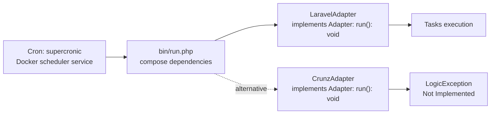

# Emorfiq Scheduler Adapter

A PHP foundation for integrating task schedulers through application-owned
interfaces. Its purpose is to allow scheduling libraries to change without
coupling application code to their types.

The current foundation provides:

- A framework-independent `Adapter` execution contract with `run(): void`.
- A `LaravelAdapter` prototype that runs `PingTask` once for each configured definition on each invocation.
- A `CrunzAdapter` placeholder that reports `Not Implemented`.
- JSON configuration validated and mapped to immutable application objects through `nette/schema`.
- A Docker environment using **PHP 8.5**, with separate execution and web services.
- Static analysis and coding-standard checks for local development and CI.

## Run locally

Requires Docker with Compose v2+ and Make. PHP and Composer run inside Docker;
neither needs to be installed on the host.

```sh
cd src
make up
```

The UI is available at **[http://localhost:8088](http://localhost:8088)** and lets
you view live task logs.
To use a different port, run `APP_PORT=8090 make up`. After changing source files,
run `make up` again to rebuild the application.

The Docker environment is intended for local development. The web service uses
PHP's development server and is exposed only on `127.0.0.1`.

## Makefile commands

| Command | Purpose |
| --- | --- |
| `make up` | Build and start the web server and cron in Docker. |
| `make down` | Stop the application while keeping its logs. |
| `make logs` | Follow cron output and adapter errors in the terminal. |
| `make test` | Run all tests in a separate Docker container. |
| `make check` | Run PHPStan, ECS coding-standard checks, and the test suite in a separate Docker container. |

## Runtime connections

- Cron starts the process.
- `bin/run.php` assembles dependencies and calls `Adapter::run()`.
- `LaravelAdapter` is selected by default.
- `CrunzAdapter` implements the same contract as the alternative and currently
  throws `LogicException('Not Implemented')`.
- The adapter handles job execution.



- `scheduler` starts a new CLI process every second during development.
  Its healthcheck monitors the cron process.
- `SchedulerConfiguration::getConfiguration()` returns an immutable `Configuration` with typed task definitions.
  `InMemorySchedulerConfiguration` loads and validates `config/scheduler.json` once during construction.
  `DatabaseSchedulerConfiguration` exposes the same method and currently throws `ConfigurationException('Not Implemented')`.
  `bin/run.php` supplies the in-memory provider to `LaravelAdapter`.
  The adapter runs each configured `PingTask` definition once per invocation; an empty task list runs nothing.
  Other task classes raise `LogicException`. Cron and time zone evaluation remain pending.
- Planned: the adapter translates configuration for the selected scheduler and
  coordinates mutex locking; the scheduler evaluates due jobs and executes them.
  Scheduler and mutex integration are not implemented yet.

## Documentation

Start the documentation as a separate local service:

```sh
make docs
```

Open **[http://localhost:8089](http://localhost:8089)**. Only the documentation
container starts; it does not require the web server or scheduler. To select
another port, run `DOCS_PORT=8091 make docs`. Changes under `docs/site/` rebuild
the preview and refresh the browser automatically. Stop it with `make docs-stop`.

The site uses the same Material for MkDocs image, theme, navigation features,
and system fonts as the E2B documentation. Its first page documents only the
[JSON scheduler configuration](docs/site/content/index.md). Other files under
`docs/` are outside the published site.

| Command | Purpose |
| --- | --- |
| `make docs` | Start the independent documentation service and print its URL. |
| `make docs-stop` | Stop the documentation service. |
| `make docs-check` | Validate and build the documentation in a temporary container. |
| `make docs-export` | Build the static site in `build/docs/` for publication. |

### GitHub Pages

In the repository's **Settings → Pages → Build and deployment**, set **Source**
to **GitHub Actions**. The `Documentation Pages` workflow builds and publishes
the site when changes reach `main`, or when manually run on `main`. CI also
validates the documentation on pull requests.

The default publication URL is
[https://pupitooo.github.io/emorfiq-adapter/](https://pupitooo.github.io/emorfiq-adapter/).
The workflow reads the actual Pages URL, including its repository path or custom
domain. To export for another address locally, use
`DOCS_SITE_URL=https://example.com/docs/ make docs-export`.
