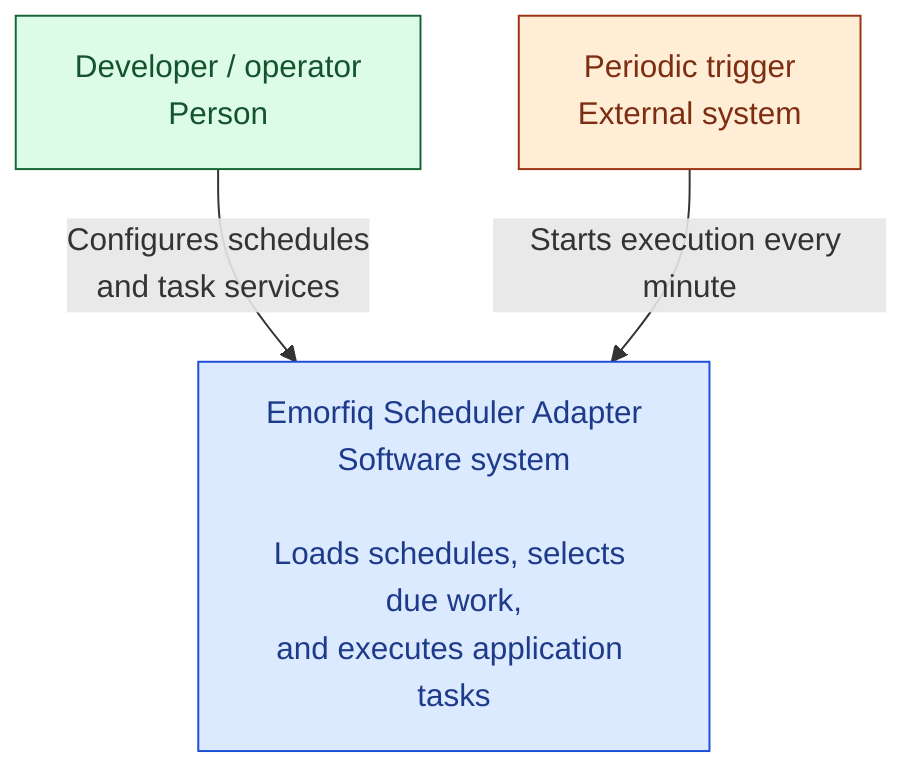

# Emorfiq Scheduler Adapter

A PHP foundation for integrating task schedulers through application-owned
interfaces, so scheduling libraries can change without coupling application code
to their types.

Source code: **[GitHub repository](https://github.com/pupitooo/emorfiq-adapter)**.

## Run locally

Requirements on the host:

- Docker (with Compose v2+)
- Make

PHP 8.5, PostgreSQL and Composer run in containers.

```sh
make up
make migrate
```

- Adapter UI: **[http://localhost:8088](http://localhost:8088)**.
- Stop: `make down`. Rebuild after source changes: `make up`.
- [Database migrations](docs/development/migrations.md)
- [Reset the database](docs/development/local-environment.md#reset-database-and-logs)
- Ports, logs, and checks: [Local environment](docs/development/local-environment.md).
- Sample simulations, worker crash, and late completion: [Concurrency demo](docs/development/concurrency-demo.md).

## Documentation

Read the **[public documentation](https://pupitooo.github.io/emorfiq-adapter/)**
on GitHub Pages, or start a local preview:

```sh
make docs
```

Open **[http://localhost:8089](http://localhost:8089)**. The documentation runs
independently of the application and refreshes automatically when Markdown changes.
Stop it with `make docs-stop`.
See [Documentation workflow](docs/development/documentation.md) for validation,
export, and GitHub Pages publication.

## Architecture



*This diagram shows only the conceptual schema of the adapter.*

### Recommended reading order

1. **[Code overview](docs/architecture.md)** — Find component responsibilities,
   replaceable boundaries, and their locations in the code.
2. **[Adapter](docs/adapter/index.md)** — Understand the invocation cycle, due-task
   selection, and scheduler integration.

    - [Laravel integration](docs/adapter/laravel.md)

3. **Configuration**

    - [Scheduler JSON](docs/configuration/format.md) — Schedules and validation.
    - [Configuration design](docs/configuration/loading.md) — Loading and design decisions.
    - [Concurrency](docs/configuration/concurrency.md) — Protection options.
    - [Service wiring](docs/configuration/services.md) — Dependencies and implementation choices.

4. **Tasks**

    - [Task services](docs/task-services.md) — Register tasks.
    - [Dependency resolution](docs/task-resolution.md) — Resolve task dependencies.
    - [Execution outcomes](docs/task-execution.md) — Handle task results and failures.

5. **[Mutex layers](docs/execution/mutex-layers.md)** — Separate scheduler gates,
   application coordination, and persistence. **[TODO: review and clarify]**
6. **Persistent coordination**

    - [Admission and completion](docs/execution/coordination.md)
    - [History and locks](docs/execution/history.md)
    - [Storage transactions](docs/execution/storage.md)

7. **Failure and recovery**

    - [Recovery](docs/execution/recovery.md) — Crashes and expiration.
    - [External effects](docs/execution/external-effects.md) — Idempotency and stale workers.

8. **Verification**

    - [Concurrency demo](docs/development/concurrency-demo.md)
    - [Recovery verification](docs/execution/verification.md)
