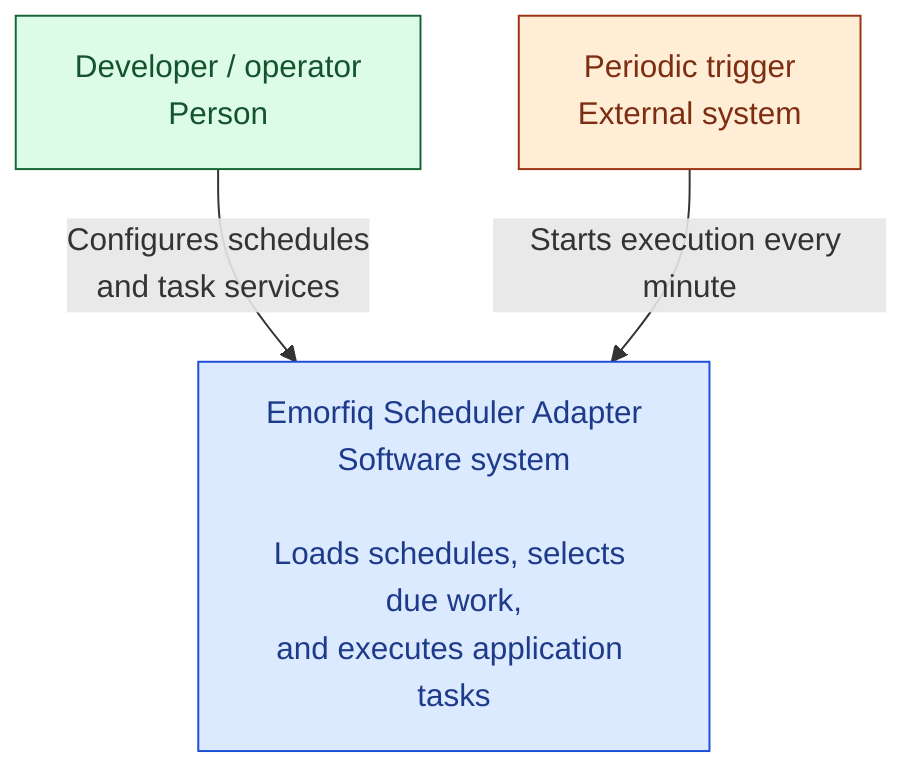

# Emorfiq Scheduler Adapter

A PHP foundation for integrating task schedulers through application-owned
interfaces, so scheduling libraries can change without coupling application code
to their types.

Source code: **[GitHub repository](https://github.com/pupitooo/emorfiq-adapter)**.

## Run locally

Requirements:

- Docker with Compose v2+
- Make

PHP 8.5, PostgreSQL and Composer run inside Docker.

```sh
make up
make migrate
```

- Adapter UI: **[http://localhost:8088](http://localhost:8088)**.
- Stop: `make down`. Rebuild after source changes: `make up`.
- [Database migrations](docs/development/migrations.md)
- [Reset the database](docs/development/local-environment.md#reset-database-and-logs)
- Ports, logs, and checks: [Local environment](docs/development/local-environment.md).
- Sample simulations, worker crash, and late completion: [Concurrency demo](docs/development/concurrency-demo.md).

## Documentation

Read the **[public documentation](https://pupitooo.github.io/emorfiq-adapter/)**
on GitHub Pages, or start a local preview:

```sh
make docs
```

Open **[http://localhost:8089](http://localhost:8089)**. The documentation runs
independently of the application and refreshes automatically when Markdown changes.
Stop it with `make docs-stop`.
See [Documentation workflow](docs/development/documentation.md) for validation,
export, and GitHub Pages publication.

## Architecture



*C4 level 1 — system context. Green identifies the person configuring the system,
orange the external trigger, and blue the adapter as a whole.*

The developer or operator supplies schedules and registers application tasks and
their dependencies. The periodic trigger starts the adapter, which loads the
configuration and selects due work through a replaceable scheduler integration.
Before resolving each admitted task, it confirms run history and any requested
concurrency locks in PostgreSQL, then resolves the task through application-owned
contracts and calls `Task::run()`.
Configuration loading, scheduler integration, dependency injection, and task
execution all belong inside the blue system boundary.

See [Architecture](docs/architecture.md) for the detailed execution flow,
contracts, dependency boundaries, and current implementation limits.
Use [Task services](docs/task-services.md) to add tasks and their dependencies,
[Task execution](docs/task-execution.md) for lifecycle logs and failure handling,
and [Scheduler JSON](docs/configuration/format.md) to configure schedules.
See [History and locks](docs/execution/history.md) for persistent execution records
and concurrency coordination.
