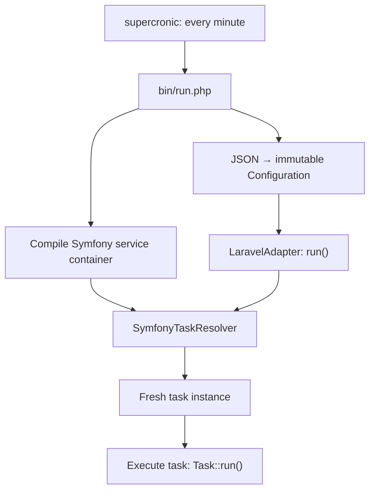

# Emorfiq Scheduler Adapter

A PHP foundation for integrating task schedulers through application-owned
interfaces, so scheduling libraries can change without coupling application code
to their types.

Source code: **[GitHub repository](https://github.com/pupitooo/emorfiq-adapter)**.

## Run locally

Requires Docker with Compose v2+ and Make. PHP 8.5 and Composer run inside Docker.
From the application directory (`src/` in the development workspace), run:

```sh
make up
```

Open the live task logs at **[http://localhost:8088](http://localhost:8088)**.
Run `make down` to stop the application. After changing source files, run
`make up` again to rebuild it. See [Local environment](docs/development/local-environment.md)
for ports, logs, and checks.

## Documentation

Read the **[public documentation](https://pupitooo.github.io/emorfiq-adapter/)**
on GitHub Pages, or start a local preview:

```sh
make docs
```

Open **[http://localhost:8089](http://localhost:8089)**. The documentation runs
independently of the application and refreshes automatically when Markdown changes.
Stop it with `make docs-stop`.

## Architecture



Cron invokes `bin/run.php`, which loads JSON schedules and compiles the Symfony
service container. `LaravelAdapter` resolves tasks through the application-owned
`TaskResolver` contract and executes each task by calling `Task::run()`.
The service container supplies its constructor dependencies.

The current prototype runs every configured definition once per invocation.
Cron/time zone evaluation, mutex locking, and Crunz integration remain pending.

| Topic | Documentation |
| --- | --- |
| Execution flow, directories, and dependency boundaries | [Architecture](docs/architecture.md) |
| Adding tasks and constructor dependencies | [Task services](docs/task-services.md) |
| Schedule fields, cron, time zones, and validation | [Scheduler JSON](docs/configuration/format.md) |
| Docker services, ports, logs, and checks | [Local environment](docs/development/local-environment.md) |
| Preview, build, and GitHub Pages publication | [Documentation workflow](docs/development/documentation.md) |
