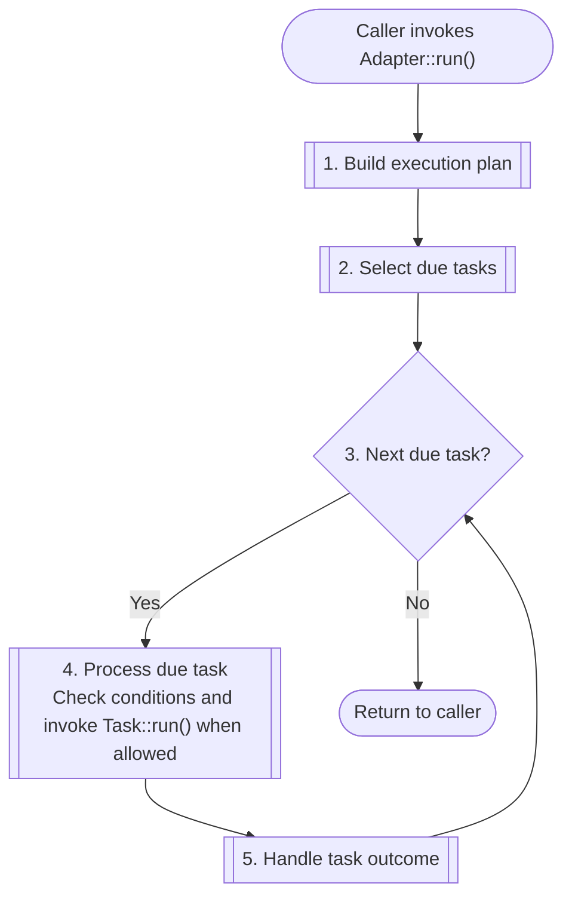

# Adapter

The adapter builds an execution plan, selects tasks due now and invokes
`Task::run()` when their execution conditions allow. One call to `Adapter::run()`
performs the cycle below.

## Invocation cycle



*One cron-triggered invocation. Due tasks are processed in configuration order;
cron triggers the adapter every minute.*

### Lifecycle stages

Each named block defines a responsibility that more detailed diagrams can expand.
The links show the current Laravel implementation and its boundary between
scheduler-provided mechanisms and application-owned orchestration:

| Block | Responsibility |
| --- | --- |
| **[Build execution plan](laravel.md#build-execution-plan)** | The adapter owns configuration-to-event mapping; the scheduler supplies its plan and callback APIs. Configuration loading belongs to the application; see [Configuration design](../configuration/loading.md). |
| **[Select due tasks](laravel.md#select-due-tasks)** | Delegate cron, time-zone and due-time evaluation to the scheduler. The adapter calls selection and processes the results in configuration order. See [cron rules](../configuration/cron.md). |
| **[Process due task](laravel.md#process-due-task)** | The adapter orchestrates checks; the scheduler supplies filter, mutex-gate and callback mechanics. The application supplies [lock services](../configuration/concurrency.md#implementation-status), and its executor invokes `Task::run()`. |
| **[Handle task outcome](laravel.md#handle-task-outcome)** | The application owns lifecycle logging, task exception translation and the continue-or-abort policy. This uses our runner's [failure handling](../task-execution.md#failure-policy), rather than delegating it to the scheduler's CLI runner. |

The diagram starts with the adapter's dependencies already supplied. Each task
is treated as an available dependency exposing `Task::run()`; its acquisition is covered in
[Task resolution](../task-resolution.md).

## Invocation trigger

The adapter follows the standard cron-driven invocation model documented by
[Laravel Scheduler](https://laravel.com/docs/13.x/scheduling#running-the-scheduler)
and [Crunz](https://github.com/crunzphp/crunz#how-it-works): a single cron entry
starts the scheduler runner every minute. The runner evaluates the task schedules
and executes only tasks that are due. The minutely trigger does not mean that
every task runs every minute; each task keeps its own cron expression.

One adapter invocation processes the currently due tasks and returns. The
external trigger provides subsequent invocations; the adapter does not wait
inside `run()` for a future cron time.

### Project cron entry

The current `docker/crontab` contains:

```cron
* * * * * php /app/bin/run.php
```

The five `*` fields select every minute. In the Docker `scheduler` service,
supercronic reads this file and starts the PHP entry point. After preparing
configuration and dependencies, `bin/run.php` invokes the adapter:

```php
$adapter->run();
```

This call starts the [Invocation cycle](#invocation-cycle). The current entry point selects
`LaravelAdapter`; a future `CrunzAdapter` is intended to use the same external
trigger and `Adapter::run()` boundary.

### Corresponding library runners

The standard library runners use the same division of responsibility: cron
provides the minutely trigger, and the runner decides which tasks are due.

| Integration | Command started by cron |
| --- | --- |
| Laravel application | `php artisan schedule:run`, from the application directory. |
| Crunz application | `vendor/bin/crunz schedule:run`, from the project directory. |
| This adapter project | `php /app/bin/run.php`, as shown in the project crontab. |

## Implementations

The common lifecycle applies to `LaravelAdapter` and a future `CrunzAdapter`
without exposing scheduler-specific APIs in the overview.

- [LaravelAdapter](laravel.md) expands each named block with implementation-specific
  diagrams.

`CrunzAdapter` is currently a placeholder; the invocation cycle describes the
common lifecycle intended for that integration as well.

## Limitations and extensions

### Design trade-offs

- **A smaller portable API.** The common lifecycle exposes scheduled
  `Task::run()` execution. It does not automatically expose every feature of each
  scheduler, such as native job or command types and framework-specific hooks.
  Those capabilities need explicit integration rather than being implied by the
  common contract.
- **Responsibility for our runner.** We reuse scheduler mechanisms but own the
  orchestration around them. Upstream CLI-runner (`schedule:run`) behavior and
  fixes are not automatically adopted by our loop (`LaravelAdapter::runEvents()`).
  Laravel's full application context and
  Artisan task events are outside the current integration; see the
  [execution boundary](../task-execution.md#integration-boundary).
- **A minimal task protocol.** `Task::run(): void` communicates completion by
  returning or throwing. Structured results, progress, cooperative cancellation
  and workflow dependencies have no common protocol here. Adding such a protocol
  requires an explicit extension to the execution model.

These are costs of the current boundary, not claims that the underlying
schedulers lack those capabilities. I chose this boundary to illustrate how the
application and scheduling library connect while keeping the implementation
simple. It provides a starting point that can be extended as the project's
requirements become clear.

For each additional layer, consider whether it preserves the ability to switch
to another scheduling library. New capabilities need defined semantics for each
supported adapter. If a capability depends on a specific library, adopting it
also means accepting that switching libraries may require implementing that
functionality ourselves.

### Current implementation limits

| Area | Current behavior and missing capability |
| --- | --- |
| Timing | The [minutely trigger](#invocation-trigger) and [five-field schedules](../configuration/cron.md#validation-and-execution-limits) provide minute precision. The runner selects work due now; it has no sub-minute loop or missed-occurrence catch-up. |
| Execution | Callbacks execute sequentially in the runner process. Long tasks delay later tasks. There is no runner-managed worker queue, task timeout or cancellation; see possible approaches to [parallel execution](#parallel-execution). |

### Possible extensions

- **Retry and catch-up policies:** define retry limits, backoff and handling of
  missed occurrences as explicit execution policies. The current recovery design
  does not retry abandoned work. Durable history alone cannot guarantee business
  effects happen exactly once; see [external effects](../execution/external-effects.md).
- **Shared queue and workers:** both adapters could submit task and occurrence
  identifiers through one dispatch contract. Workers would resolve tasks and call
  `TaskExecutor`, with concurrency controlled by the worker count. A queue system
  could supply retries, backoff and execution timeouts independently of the
  scheduling library. Define ordering, failure and cancellation semantics, and
  consider renewal if long tasks must retain their overlap lock; see
  [long-task limits](../execution/recovery.md#long-tasks-without-renewal).
- **Finer scheduling precision:** update both the trigger and runner if tasks
  need to be scheduled more frequently than once per minute.
- **Additional integrations:** implement `CrunzAdapter`, alternative configuration
  providers or explicitly selected scheduler-specific capabilities. Each
  integration must document the same responsibility boundaries and which behavior
  remains application-owned.

### Parallel execution

Choose an approach only after understanding the project's execution requirements.
The choice determines our dependency on the selected system and which capabilities
we must implement ourselves. Assess both the behavior it provides and the work
needed to preserve that behavior if the system is replaced.

- **Laravel background commands:** add a shared CLI entry point that executes a
  task by schedule ID, then schedule it with `exec()->runInBackground()`. Task
  classes can remain unchanged. Laravel's background mode automatically invokes
  `schedule:finish` after the task exits to run completion callbacks and release
  overlap locks. Its command and runtime must therefore be available; our current
  callbacks do not support background execution.
- **Crunz processes:** a future adapter could use Crunz's native runner to start
  tasks in separate processes through the same task CLI entry point.
  See [Crunz: Parallelism and the Locking Mechanism](https://github.com/crunzphp/crunz#parallelism-and-the-locking-mechanism).
- **Shared process executor:** introduce a scheduler-independent component that
  starts task processes and limits their concurrency, for example using Symfony
  Process. Process supervision and outcome handling would remain our responsibility.
- **Queue workers:** use the shared queue described above when durable work
  handoff and queue-managed retries or timeouts are also needed. A queue is
  optional for parallel execution.

All these approaches require each execution process to initialize its own
application dependencies. Share bootstrap code and explicitly pass the required
task context, including the configuration snapshot or version to use; in-memory
objects and state are not automatically transferred. These are proposed options;
the current adapter still executes tasks sequentially.
