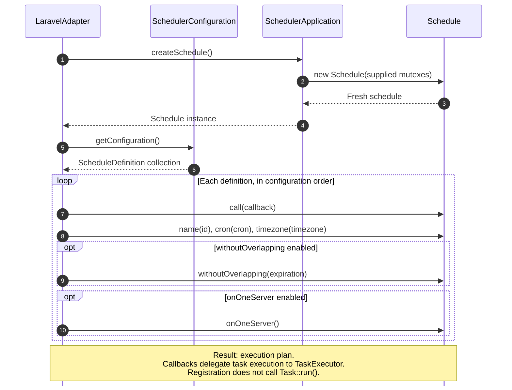
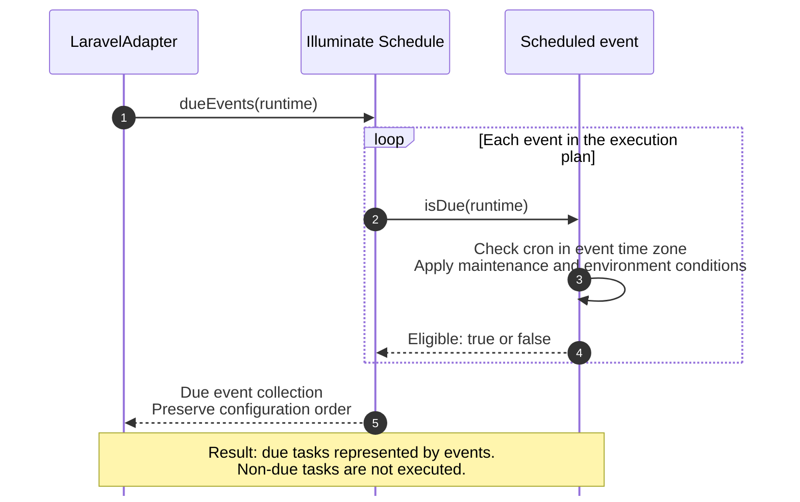
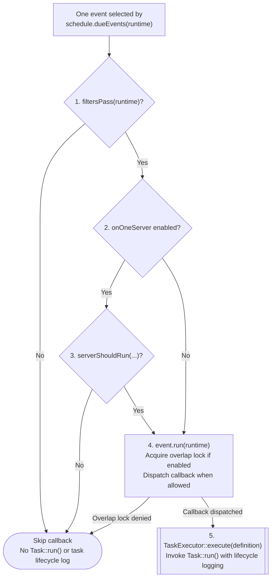
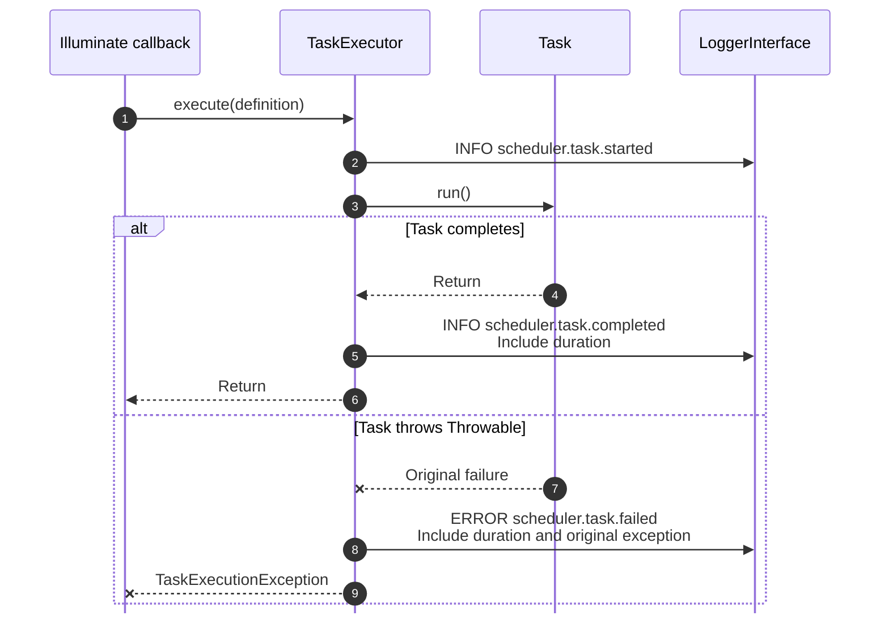
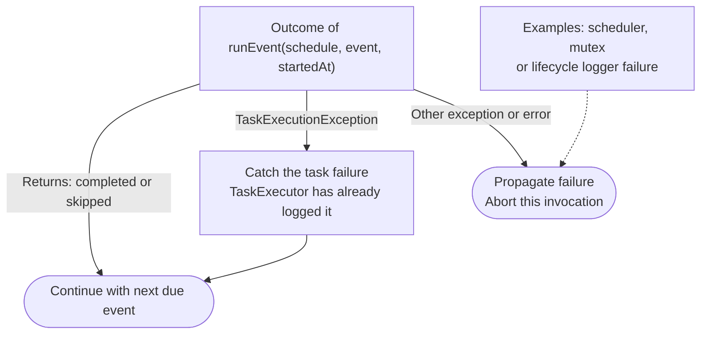

# LaravelAdapter

The adapter reuses Illuminate's scheduling rules and execution gates. The
application owns task resolution, lifecycle logging and failure policy. The final
section, [What does the library contribute?](#what-does-the-library-contribute),
compares these responsibilities and asks whether the reused behavior justifies
the integration and maintenance cost.

These diagrams expand the named blocks of the shared
[Invocation cycle](index.md#invocation-cycle) for `LaravelAdapter`. They follow
the same phase order and keep each task abstract: an available dependency whose
only operation is `Task::run()`. Task acquisition is described in
[Task resolution](../tasks/dependency-resolution.md).

Each scheduled task is represented by an Illuminate callback event. The term
**event** below refers to that scheduling-library object.

## Contents

- [Build execution plan](#build-execution-plan)
- [Select due tasks](#select-due-tasks)
- [Process due task](#process-due-task)
    - [Execution conditions](#execution-conditions)
    - [Task invocation and logging](#task-invocation-and-logging)
- [Handle task outcome](#handle-task-outcome)
- [What does the library contribute?](#what-does-the-library-contribute)

## Build execution plan

Expands **Build execution plan** in the [Invocation cycle](index.md#invocation-cycle).
`LaravelAdapter::createSchedule()` translates definitions into Illuminate
callback events. Registration records what should run and when; it does not
invoke tasks.

**Responsibility boundary:** the adapter owns definition-to-event mapping.
Illuminate supplies the schedule and callback-event implementation.
`SchedulerApplication` supplies the runtime and mutex dependencies; the custom
`Schedule` constructor initializes those dependencies explicitly.

## Select due tasks

Expands **Select due tasks** in the [Invocation cycle](index.md#invocation-cycle).
Illuminate's `Schedule::dueEvents()` filters the prepared plan. Due events retain
their configuration order and enter **Process due task** one at a time.

**Responsibility boundary:** due-time evaluation is delegated to Illuminate's
`Schedule::dueEvents()` and `Event::isDue()`; the adapter does not implement its
own cron evaluator. The application supplies `SchedulerApplication` as the
runtime context for environment and maintenance checks.

## Process due task

Expands **Process due task** in the [Invocation cycle](index.md#invocation-cycle).
The adapter applies execution gates to one due event, then lets Illuminate
dispatch its callback. The callback invokes `TaskExecutor`, which wraps
`Task::run()` with lifecycle logging.

### Execution conditions

This view ends at callback dispatch. The next view expands task invocation within
the same **Process due task** block.

**Responsibility boundary:** our runner decides when to call `filtersPass()`,
`serverShouldRun()` and `event.run()`. Illuminate implements those gates and
callback dispatch. The application supplies the mutex services and their storage;
it does not receive Laravel's standard cache-backed mutex setup automatically.

When `withoutOverlapping` is enabled, `filtersPass()` also checks for an existing
lock. `event.run()` then attempts acquisition, covering a competing execution
that starts between those checks.
The [coordinated mutexes](../mutex/layers.md) share one committed
reservation through `ExecutionCoordinator` and PostgreSQL storage. Storage
failures take the infrastructure-failure path in **Handle task outcome**.

### Task invocation and logging

At this boundary the task is considered available. This view follows only its
`run()` call and the execution wrapper around it.

**Responsibility boundary:** task invocation and lifecycle logging belong to
the application's `TaskExecutor`. They are independent of Artisan's
`ScheduledTaskStarting`, `ScheduledTaskFinished` and `ScheduledTaskFailed` events;
see the [execution boundary](../tasks/execution-outcomes.md#integration-boundary).

The result leaves **Process due task** and enters **Handle task outcome**. See
[Task execution](../tasks/execution-outcomes.md) for lifecycle record fields and logging
details, including failures during task acquisition, which is abstracted out here.

## Handle task outcome

Expands **Handle task outcome** in the [Invocation cycle](index.md#invocation-cycle).
The adapter isolates reported task failures so later due events can continue.
Infrastructure failures propagate and abort the invocation.

**Responsibility boundary:** Illuminate propagates callback failures, but our
executor wraps task errors and our `runEvents()` loop catches only
`TaskExecutionException`. Continuing after those errors and aborting on other
failures are application-owned policies, not behavior inherited by invoking
Artisan's runner.

Plan construction and due-time selection failures also propagate before the
event loop starts. The adapter performs no automatic retry or rollback.
The [failure policy](../tasks/execution-outcomes.md#failure-policy) documents process exit
status and the complete exception boundary.

## What does the library contribute?

The current integration reuses scheduler mechanisms while keeping application
policy explicit. The practical boundary is:

| Responsibility | Provided by Illuminate | Owned by the application |
| --- | --- | --- |
| Task selection | Schedule objects, cron and time-zone evaluation using `cron-expression`. | Supply definitions, build the plan and invoke selection. |
| Execution conditions | Filter evaluation, overlap checks, single-server gate and callback lifecycle. | Choose when to call these mechanisms and supply mutex implementations and storage. |
| Task execution | Dispatch the registered callback. | Resolve the task, invoke `Task::run()`, log its lifecycle and decide whether failures abort the invocation. |
| Runtime | Scheduler APIs and container contracts. | Supply the standalone context and maintain compatibility with the Illuminate APIs used. |

The main benefit is reusing the implementation of scheduling rules and execution
gates, including changes in the library methods we call. We still own their
orchestration; the full behavior of Artisan's runner is outside this boundary.
The [adapter overview](index.md#design-trade-offs) describes that trade-off.

Questions to revisit as requirements develop:

- **What do we actually reuse?** Distinguish behavior exercised by this adapter
  from capabilities available only through Laravel's full runtime or runner.
- **Which decisions belong to our application?** Keep task contracts and project
  policies explicit, and assess whether additional execution mechanisms should
  be delegated to an existing runner or implemented in a shared application layer.
- **What would switching libraries require?** Identify which contracts and task
  implementations remain usable, and which runtime, locking and execution
  behavior would need another implementation.
- **Where is the strongest reason to keep the library?** Does the scheduler
  behavior we reuse justify the integration and maintenance cost, compared with
  using a cron-expression library directly? If broader execution features become
  necessary, would delegating more responsibility increase that value?
