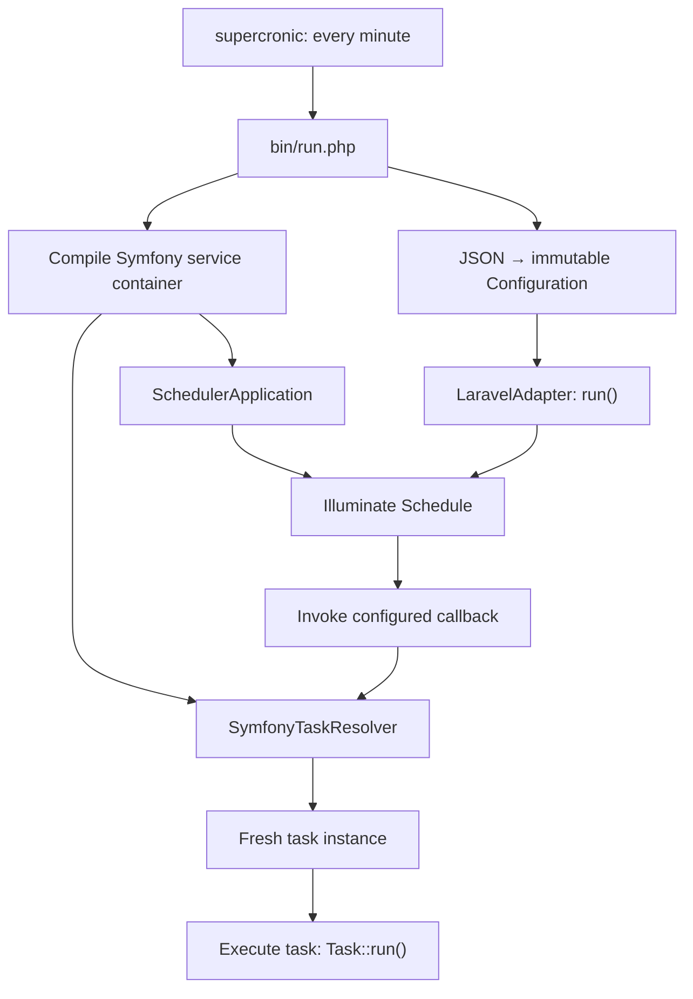

# Architecture

Application code is grouped by capability under `app/`. Application-owned
contracts keep task execution and scheduler configuration independent of vendor
libraries.

## Execution flow



1. The Docker `scheduler` service runs `supercronic` using `docker/crontab`.
   It starts a new PHP CLI process every minute.
2. `bin/run.php` loads `config/services.php` and compiles a new Symfony container
   for that invocation. It also constructs `InMemorySchedulerConfiguration` with
   `config/scheduler.json`, retrieves `SchedulerApplication` from the container,
   and supplies the configuration, task resolver, and scheduler context to the adapter.
3. The configuration provider reads and validates JSON once during construction.
   `getConfiguration()` returns the same immutable `Configuration` snapshot,
   containing a list of `ScheduleDefinition` objects.
4. `LaravelAdapter` builds a fresh Illuminate `Schedule`, mapping each definition
   to a callback event with its identifier, cron expression, and time zone.
   Registration does not resolve tasks.
5. `run()` currently executes every registered event. Inside each callback it
   asks `TaskResolver` for the task and calls `Task::run()`. An empty task list
   runs nothing. Each definition receives a fresh task instance.

See [Task services](task-services.md) for registration and resolution failures,
and [Scheduler JSON](configuration/format.md) for fields and validation.

## Dependency boundaries

| Area | Responsibility and boundary |
| --- | --- |
| Scheduler contracts | `Adapter::run()` starts execution; `SchedulerConfiguration` supplies typed configuration. Neither contract exposes vendor types. |
| Scheduler domain | Immutable configuration and schedule values, independent of Nette Schema and scheduler libraries. |
| Configuration infrastructure | File access and JSON mapping through Nette Schema. Invalid configuration raises `ConfigurationException`. |
| Task contracts | `Task::run()` describes work; `TaskResolver::resolve()` retrieves an executable task. |
| Task infrastructure | `SymfonyTaskResolver` adapts the compiled container to `TaskResolver`. Scheduler adapters depend on the contract. |
| Task execution | Concrete tasks depend on constructor-injected services such as PSR-3 `LoggerInterface`. |
| Composition | `bin/run.php` and `config/services/` choose implementations and wire dependencies. |

## Current implementation and pending work

The [Laravel Scheduler integration](laravel-scheduler.md) provides a separate
Illuminate container and minimal scheduler context, registered in Symfony DI.
`LaravelAdapter` uses this context to build callback schedules and execute their
events. Task construction remains in Symfony.

`LaravelAdapter` is an execution prototype. It runs every configured definition
once on every invocation, regardless of its cron expression or time zone.
Definitions are translated into Scheduler events, but due-time filtering and
functional mutex locking remain pending. Mutex placeholders throw
`LogicException('Not Implemented')` if a lock operation is requested.
The container is compiled for each invocation; it is not cached between processes.

`CrunzAdapter` implements the same adapter contract but currently throws
`LogicException('Not Implemented')`. `DatabaseSchedulerConfiguration` implements
the configuration provider contract but throws
`ConfigurationException('Not Implemented')`.

## Directory layout

Paths are relative to the application root.

```text
app/
  Scheduler/
    Contract/                 Adapter and SchedulerConfiguration
    Domain/                   Configuration and ScheduleDefinition
    Exception/                ConfigurationException
    Infrastructure/
      Configuration/          JSON parser, in-memory provider, database placeholder
      Laravel/                Execution adapter and Illuminate scheduler context
      Crunz/                  Alternative adapter placeholder
  Task/
    Contract/                 Task and TaskResolver
    Execution/                Concrete task implementations, including PingTask
    Infrastructure/Symfony/   SymfonyTaskResolver
bin/run.php                   CLI composition and execution entry point
config/
  scheduler.json              Schedule definitions
  services.php                Imports service configuration
  services/
    logging.php               Shared Monolog logger and PSR-3 alias
    scheduler.php             Illuminate scheduler context
    tasks.php                 Task discovery and constructor autowiring
docker/crontab                Periodic invocation of the CLI entry point
```

Composer maps the application namespace `App\` to `app/`.
