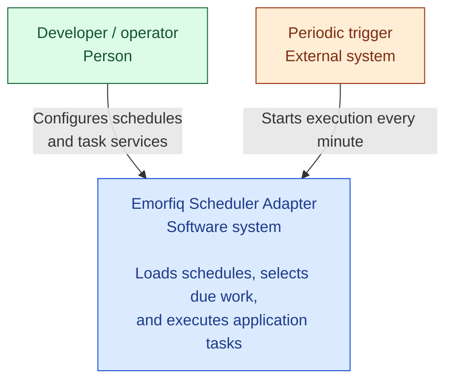

# Code overview

Each CLI invocation:

- Prepares configuration and dependencies.
- Selects due tasks.
- Confirms execution history and requested concurrency locks.
- Resolves tasks and calls `Task::run()`.

This page maps those responsibilities to the code;
[Adapter](adapter/index.md) explains the execution cycle.

## System context

The diagram shows the adapter as one software system, the
developer or operator configuring it, and the external periodic trigger.



## Responsibilities and code

Follow the topic links for details.

| Responsibility | Where to look in code | Documentation |
| --- | --- | --- |
| Prepare dependencies and start the adapter. | `run.php`<br>`services.php` | [Service wiring](development/service-wiring.md) |
| Load and validate schedules into immutable configuration objects. | `InMemorySchedulerConfiguration.php`<br>`JsonConfigurationParser.php` | [Configuration design](configuration/loading.md), [JSON format](configuration/format.md) |
| Map definitions to scheduler events, select due work, and run execution gates. | `LaravelAdapter.php`<br>`SchedulerApplication.php`<br>`Schedule.php` | [Adapter](adapter/index.md), [Laravel integration](adapter/laravel.md) |
| Share one execution claim between scheduling gates and the callback; record the outcome. | `ScheduledExecution.php`<br>`ExecutionCoordinator.php`<br>`CoordinatedEventMutex.php`<br>`CoordinatedSchedulingMutex.php`<br>`EventExecutions.php` | [Mutex layers](execution/mutex-layers.md), [Coordination](execution/coordination.md) |
| Persist history and requested locks through atomic database operations. | `PostgresTaskRunStorage.php`<br>`PostgresConnectionFactory.php` | [History and locks](execution/history.md), [Storage](execution/storage.md) |
| Resolve task instances and their constructor dependencies. | `SymfonyTaskResolver.php` | [Task resolution](task-resolution.md) |
| Invoke `Task::run()` with lifecycle logging and task failure handling. | `TaskExecutor.php` | [Task execution](task-execution.md), [Task services](task-services.md) |

## How the parts can be replaced

The intended split keeps scheduling, configuration, task construction, and
storage replaceable independently. The shared code asks for an interface
(a contract describing the operations it needs), rather than a particular
library or database implementation.

The folders reflect this split:

- **Contract** defines the interfaces that components agree to use.
- **Domain** holds shared values such as schedule definitions and execution
  claims. These objects expose no scheduler, container, or database-library types.
- **Application** coordinates execution through those contracts: claim a run,
  resolve the task, invoke it, and record its outcome.
- **Infrastructure** connects a contract to a specific technology, such as
  Illuminate scheduling, Symfony service lookup, JSON parsing, or PostgreSQL.

Dependencies are passed into constructors. `config/services/` chooses service
implementations through interface aliases; `bin/run.php` selects the configuration
provider and adapter. This is dependency injection: components receive their
collaborators instead of creating the concrete implementations themselves.

| To replace | Boundary that stays the same |
| --- | --- |
| Schedule source | `SchedulerConfiguration` returns the same typed `Configuration`. |
| Scheduling library | `Adapter::run()` starts the cycle; shared configuration, task, and coordination contracts remain usable. Library-specific event and mutex integration must be supplied by the new adapter. |
| Task container | `TaskResolver` returns an object implementing `Task`; the executor does not need Symfony container access. |
| Coordination storage | `ExecutionMutex` separates execution from persistence; `ExecutionCoordinator` delegates to `TaskRunStorage`, whose implementation owns database operations. |

For example, replacing PostgreSQL means implementing `TaskRunStorage` and changing
its service registration and alias. Task classes and `ScheduledExecution` continue
using the same contracts. The replacement must preserve the
[coordination guarantees](execution/coordination.md), including atomic claims and
completion checked against the original owner.

## Directory layout

Paths are relative to the application root.

```text
app/
  Database/                   PostgreSQL connection factory
  Scheduler/
    Application/              Task execution, per-occurrence lifecycle, and coordinator
    Contract/                 Adapter, configuration, execution mutex, and storage interfaces
    Domain/                   Configuration, schedule definitions, claims, and outcomes
    Exception/                Configuration, execution, and coordination failures
    Infrastructure/
      Configuration/          Configuration providers and JSON parsing
      Database/               Task run storage and coordination transactions
      Laravel/                Scheduler integration
        Runtime/              Scheduler context and Schedule
        Mutex/                Coordinated mutexes and shared event execution registry
      Crunz/                  Alternative adapter placeholder
  Task/
    Contract/                 Task and TaskResolver interfaces
    Execution/                Concrete task implementations
    Infrastructure/Symfony/   Task resolution through Symfony DI
bin/run.php                   CLI composition and execution entry point
config/
  scheduler.json              Schedule definitions
  services.php                Imports service configuration
  services/                   Service definitions, interface aliases, and dependency wiring
docker/crontab                Periodic invocation of the CLI entry point
```

Composer maps the application namespace `App\` to `app/`.
