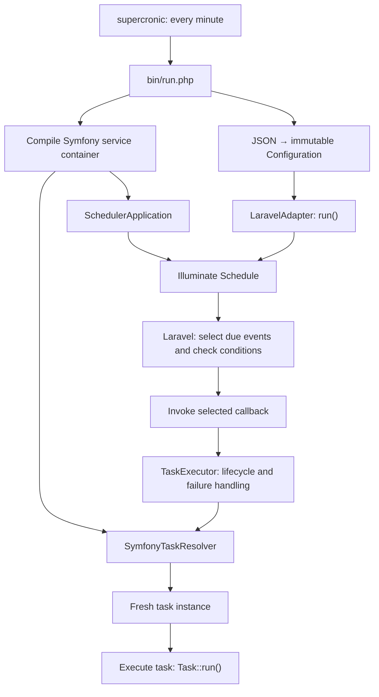

# Architecture

Application code is grouped by capability under `app/`. Application-owned
contracts keep task execution and scheduler configuration independent of vendor
libraries.

## Execution flow



1. The Docker `scheduler` service runs `supercronic` using `docker/crontab`.
   It starts a new PHP CLI process every minute.
2. `bin/run.php` loads `config/services.php` and compiles a new Symfony container
   for that invocation. It also constructs `InMemorySchedulerConfiguration` with
   `config/scheduler.json`, retrieves `SchedulerApplication` and `TaskExecutor`
   from the container, and supplies these with the configuration to the adapter.
3. The configuration provider reads and validates JSON once during construction.
   `getConfiguration()` returns the same immutable `Configuration` snapshot,
   containing a list of `ScheduleDefinition` objects.
4. `LaravelAdapter` builds a fresh Illuminate `Schedule`, mapping each definition
   to a callback event with its identifier, cron expression, time zone, and
   [concurrency options](configuration/concurrency.md).
   Registration does not resolve tasks.
5. `run()` calls Laravel's `dueEvents()` to select events for the current time,
   then checks each event's `filtersPass()` result and, when requested,
   `serverShouldRun()` result before executing it.
   Laravel evaluates the cron expression in the event's time zone.
6. Inside each selected callback, `TaskExecutor` asks `TaskResolver` for the task
   and calls `Task::run()` with lifecycle logging. Skipped definitions do not
   resolve tasks. An empty task list runs nothing; each executed definition receives a fresh task instance.

See [Task services](task-services.md) for registration and resolution failures,
[Task execution](task-execution.md) for logging and failure handling,
and [Scheduler JSON](configuration/format.md) for fields and validation.

## Dependency boundaries

| Area | Responsibility and boundary |
| --- | --- |
| Scheduler contracts | `Adapter::run()` starts execution; `SchedulerConfiguration` supplies typed configuration. Neither contract exposes vendor types. |
| Scheduler domain | Immutable configuration and schedule values, independent of Nette Schema and scheduler libraries. |
| Configuration infrastructure | File access and JSON mapping through Nette Schema. Invalid configuration raises `ConfigurationException`. |
| Task contracts | `Task::run()` describes work; `TaskResolver::resolve()` retrieves an executable task. |
| Task infrastructure | `SymfonyTaskResolver` adapts the compiled container to `TaskResolver`. `TaskExecutor` depends on the contract. |
| Scheduler application | `TaskExecutor` resolves and executes tasks with PSR-3 lifecycle logging and preserves individual failures. |
| Task execution | Concrete tasks depend on constructor-injected services such as PSR-3 `LoggerInterface`. |
| Composition | `bin/run.php` and `config/services/` choose implementations and wire dependencies. |

## Current implementation and pending work

The [Laravel Scheduler integration](laravel-scheduler.md) provides a separate
Illuminate container and minimal scheduler context, registered in Symfony DI.
`LaravelAdapter` uses this context to build callback schedules and execute their
events. Task construction remains in Symfony.

Each CLI invocation builds a plan and executes its currently due callbacks in
configuration order. Cron evaluation, time zones, aliases, and event conditions
are delegated to Laravel Scheduler. Task failures are logged while remaining
due events continue. Like Laravel's runner, the CLI completes normally after
reported task failures; infrastructure errors still abort immediately. See
[Task execution](task-execution.md#process-exit-status) for exit status semantics.

Functional mutex locking remains pending. Mutex placeholders throw
`LogicException('Not Implemented')` if a lock operation is requested.
JSON flags and their adapter mapping are implemented; protected due events fail
explicitly until the placeholders are replaced.
The container is compiled for each invocation; it is not cached between processes.

`CrunzAdapter` implements the same adapter contract but currently throws
`LogicException('Not Implemented')`. `DatabaseSchedulerConfiguration` implements
the configuration provider contract but throws
`ConfigurationException('Not Implemented')`.

## Directory layout

Paths are relative to the application root.

```text
app/
  Scheduler/
    Application/              TaskExecutor and lifecycle logging
    Contract/                 Adapter and SchedulerConfiguration
    Domain/                   Configuration and ScheduleDefinition
    Exception/                Configuration and task execution failures
    Infrastructure/
      Configuration/          JSON parser, in-memory provider, database placeholder
      Laravel/
        LaravelAdapter.php    Maps configuration and executes scheduler callbacks
        Runtime/              SchedulerApplication context and Schedule
        Mutex/                Event and single-server mutex placeholders
      Crunz/                  Alternative adapter placeholder
  Task/
    Contract/                 Task and TaskResolver
    Execution/                Concrete task implementations, including PingTask
    Infrastructure/Symfony/   SymfonyTaskResolver
bin/run.php                   CLI composition and execution entry point
config/
  scheduler.json              Schedule definitions
  services.php                Imports service configuration
  services/
    logging.php               Shared Monolog logger and PSR-3 alias
    scheduler.php             Illuminate scheduler context and TaskExecutor
    tasks.php                 Task discovery and constructor autowiring
docker/crontab                Periodic invocation of the CLI entry point
```

Composer maps the application namespace `App\` to `app/`.
