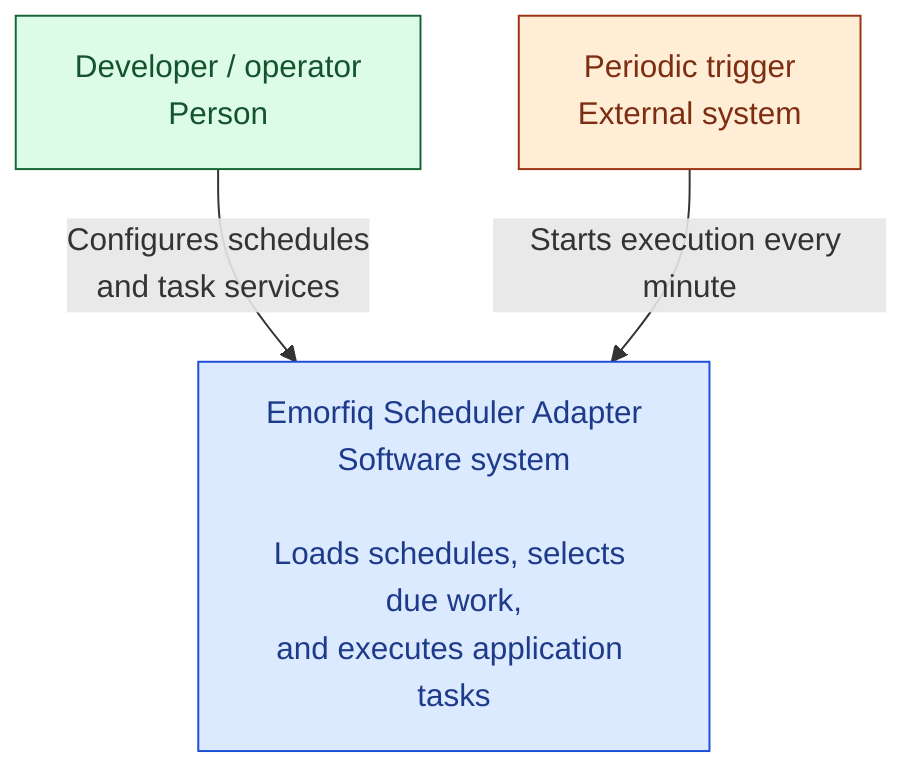
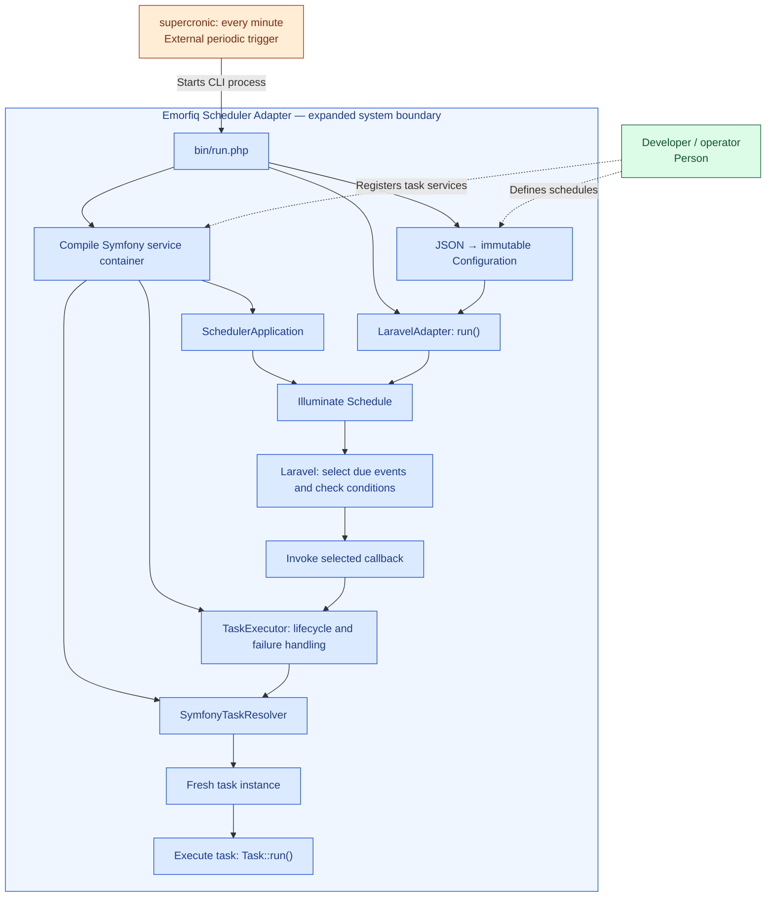

# Architecture

The adapter loads schedule configuration, selects due work through a scheduler
integration, resolves application tasks and their dependencies, and calls
`Task::run()`. Application-owned contracts keep configuration and task execution
independent of vendor libraries.

## System context

The C4 level 1 context diagram shows the adapter as one software system, the
developer or operator configuring it, and the external periodic trigger.



*C4 level 1 — system context. Green identifies the person configuring the system,
orange the external trigger, and blue the adapter as a whole.*

The blue system includes configuration loading, scheduler integration, dependency
injection, and application task execution. This follows the
[C4 system context](https://c4model.com/diagrams/system-context) view of a system
and its directly connected people and systems.

## Execution flow

The diagram below expands the blue adapter block from the context view into
implementation components and execution steps.
The same colors identify the person (green), external trigger (orange), and
adapter internals (blue).



*Detailed expansion of the context diagram. Solid arrows trace runtime setup and
execution through `Task::run()`; dotted arrows show configuration by the developer
or operator. Every blue block belongs to the single adapter system above.*

1. The Docker `scheduler` service runs `supercronic` using `docker/crontab`.
   It starts a new PHP CLI process every minute.
2. `bin/run.php` loads `config/services.php` and compiles a new Symfony container
   for that invocation. It also constructs `InMemorySchedulerConfiguration` with
   `config/scheduler.json`, retrieves `SchedulerApplication` and `TaskExecutor`
   from the container, and supplies these with the configuration to the adapter.
3. The configuration provider reads and validates JSON once during construction.
   `getConfiguration()` returns the same immutable `Configuration` snapshot,
   containing a list of `ScheduleDefinition` objects.
4. `LaravelAdapter` builds a fresh Illuminate `Schedule`, mapping each definition
   to a callback event with its identifier, cron expression, time zone, and
   [concurrency options](configuration/concurrency.md).
   Registration does not resolve tasks.
5. `run()` calls Laravel's `dueEvents()` to select events for the current time,
   then checks each event's `filtersPass()` result and, when requested,
   `serverShouldRun()` result before executing it.
   Laravel evaluates the cron expression in the event's time zone.
6. Inside each selected callback, `TaskExecutor` asks `TaskResolver` for the task
   and calls `Task::run()` with lifecycle logging. Skipped definitions do not
   resolve tasks. An empty task list runs nothing; each executed definition receives a fresh task instance.

See [Task services](task-services.md) for adding and changing tasks,
[Task resolution](task-resolution.md) for service lookup,
[Task execution](task-execution.md) for logging and failure handling,
and [Scheduler JSON](configuration/format.md) for fields and validation.

## Dependency boundaries

| Area | Responsibility and boundary |
| --- | --- |
| Scheduler contracts | `Adapter::run()` starts execution; `SchedulerConfiguration` supplies typed configuration. Neither contract exposes vendor types. |
| Scheduler domain | Immutable configuration and schedule values, independent of Nette Schema and scheduler libraries. |
| Configuration infrastructure | File access and JSON mapping through Nette Schema. Invalid configuration raises `ConfigurationException`. |
| Task contracts | `Task::run()` describes work; `TaskResolver::resolve()` retrieves an executable task. |
| Task infrastructure | `SymfonyTaskResolver` adapts the compiled container to `TaskResolver`. `TaskExecutor` depends on the contract. |
| Scheduler application | `TaskExecutor` resolves and executes tasks with PSR-3 lifecycle logging and preserves individual failures. |
| Database infrastructure | `App\Database` creates independent PDO connections. Scheduler infrastructure owns task run SQL and coordination transactions. |
| Task execution | Concrete tasks depend on constructor-injected services such as PSR-3 `LoggerInterface`. |
| Composition | `bin/run.php` and `config/services/` choose implementations and wire dependencies. |

See [Service wiring](configuration/services.md) for configuration file ownership,
database connection settings, and implementation aliases.

## Current implementation and pending work

The [LaravelAdapter integration](adapter/laravel.md) uses a separate
Illuminate container and minimal scheduler context, registered in Symfony DI.
`LaravelAdapter` uses this context to build callback schedules and execute their
events. Task construction remains in Symfony.

Each CLI invocation builds a plan and executes its currently due callbacks in
configuration order. Cron evaluation, time zones, aliases, and event conditions
are delegated to Laravel Scheduler. Task failures are logged while remaining
due events continue. Like Laravel's runner, the CLI completes normally after
reported task failures; infrastructure errors still abort immediately. See
[Task execution](task-execution.md#process-exit-status) for exit status semantics.

Protected events use `ExecutionCoordinator` and [PostgreSQL storage](execution/storage.md)
for committed reservations, owner-checked completion, and expired-run recovery.
Apply the database migrations before executing protected events. The full
worker-crash acceptance harness remains pending.
The container is compiled for each invocation; it is not cached between processes.

`CrunzAdapter` implements the same adapter contract but currently throws
`LogicException('Not Implemented')`. `DatabaseSchedulerConfiguration` implements
the configuration provider contract but throws
`ConfigurationException('Not Implemented')`.

## Directory layout

Paths are relative to the application root.

```text
app/
  Database/                   PostgreSQL connection factory
  Scheduler/
    Application/              Task execution, per-occurrence lifecycle, and coordinator
    Contract/                 Adapter, configuration, execution mutex, and storage contracts
    Domain/                   Configuration, schedule definitions, claims, and run outcomes
    Exception/                Configuration, task execution, and coordination failures
    Infrastructure/
      Configuration/          JSON parser, in-memory provider, database placeholder
      Database/               Task run storage and coordination transactions
      Laravel/
        LaravelAdapter.php    Maps configuration and executes scheduler callbacks
        Runtime/              SchedulerApplication context and Schedule
        Mutex/                Coordinated mutexes and shared event execution registry
      Crunz/                  Alternative adapter placeholder
  Task/
    Contract/                 Task and TaskResolver
    Execution/                Concrete task implementations, including PingTask
    Infrastructure/Symfony/   SymfonyTaskResolver
bin/run.php                   CLI composition and execution entry point
config/
  scheduler.json              Schedule definitions
  services.php                Imports service configuration
  services/
    logging.php               Shared Monolog logger and PSR-3 alias
    database.php              Connection settings, PostgreSQL factory, and PDO
    scheduler.php             Storage selection, coordinator, and TaskExecutor
    scheduler-laravel.php     Illuminate mutex aliases and scheduler context
    tasks.php                 Task discovery and constructor autowiring
docker/crontab                Periodic invocation of the CLI entry point
```

Composer maps the application namespace `App\` to `app/`.
