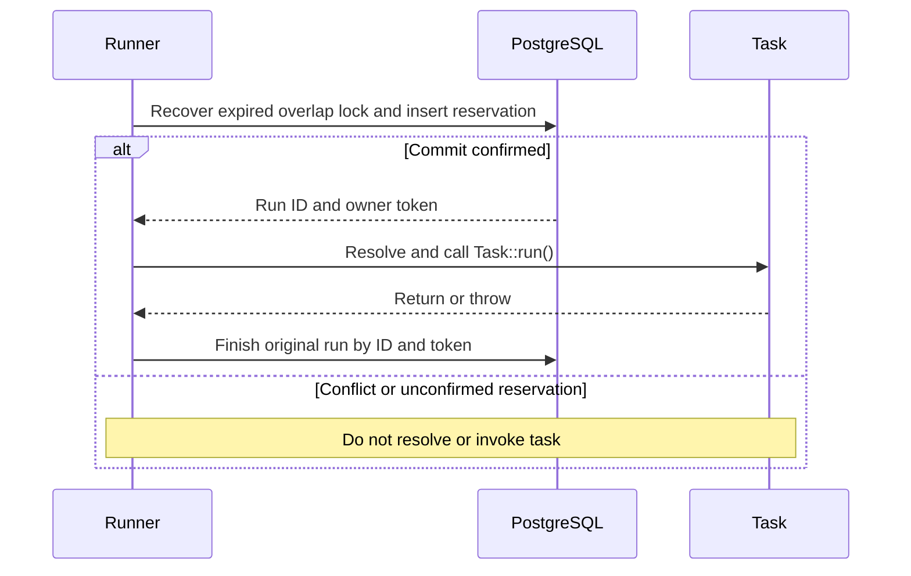

# Execution coordination

This is the agreed contract for PostgreSQL execution coordination.
The schema, application coordination layer, Laravel runner integration, and
[PostgreSQL storage](storage.md) are implemented. Storage tests exercise production
SQL and concurrency; the recovery acceptance suite covers the full Laravel
runner, worker crashes, and receiver boundaries. See [Mutex layers](mutex-layers.md)
to follow the current classes.

## Execution lifecycle

The runner reserves an occurrence in a short transaction before resolving the
service or calling `Task::run()`. Every admitted run, including an unprotected
run, gets a fresh history row ID and
unpredictable `owner_token`. The transaction must commit before task execution;
it must not remain open while the task runs.

The coordinator contract is independent of Laravel:

| Operation | Responsibility |
| --- | --- |
| Claim | Recover expired overlap locks, record history, and acquire requested locks in one transaction. Distinguish conflicts from storage failures or unknown commit outcomes. |
| Finish | Record the original run's result using its ID and owner token, even after expiry or abandonment; remove only its overlap lock. |
| Recover | Remove expired overlap locks and mark linked `in_progress` history rows `abandoned`, recording detection time and actor. |

Renewal, worker supervision, ownership-loss signals, and automatic task termination
are deferred extensions. They are not required by this first implementation.

Conflicts skip the invocation; they do not queue work or create failed run rows.
A rollback leaves no reservation. A lost commit acknowledgement may leave a
committed row, so the runner must neither invoke the task nor blindly retry an
unconfirmed claim. This deliberately prefers a missed execution over a duplicate.

## Two independent protections

An occurrence is `(schedule_id, scheduled_for)`, where `scheduled_for` is the
intended UTC minute shared by scheduler processes, not each process's start time.
All instances must use consistent IDs and concurrency options. Different IDs
remain independent even if they resolve the same task class.

| Protection | Unique index | Lifetime |
| --- | --- | --- |
| `onOneServer` | `task_locks_occurrence`: `(schedule_id, scheduled_for)` where `lock_type = 'occurrence'` | Until the lock row is explicitly deleted, independently of completion and history retention. |
| `withoutOverlapping` | `task_locks_overlap`: `schedule_id` where `lock_type = 'overlap'` | Until completion or explicit expiry recovery removes the lock row. |

Only enabled protections create lock rows. Both flags are disabled by default;
history is recorded in every case. Enabling both creates two linked locks.
See [History and locks](history.md) for the relationship and retention rules.

- `onOneServer` selects one winner for an occurrence. A 10:01 run can start while
  10:00 is still running. It neither pins a schedule to one machine nor imposes
  an execution deadline. Its rows have `lease_expires_at = NULL` unless overlap
  protection is also enabled.
- `withoutOverlapping` skips subsequent invocations while the active reservation
  remains protected. Used alone, it permits the same occurrence again after
  completion. It therefore does not replace occurrence deduplication.
- Disabling both permits concurrent runs and duplicate occurrences.

The single-server reservation remains after quick completion, preventing a
second server from executing the same scheduled minute. This reserves an
occurrence; it does not guarantee exactly-once business effects.

## Fixed overlap expiration

`overlapExpiresAfterMinutes` is the fixed overlap-lock lifetime from reservation,
with the existing default of 60 minutes. It applies only with
`withoutOverlapping: true`; no second lease-duration option is introduced.
The lock deadline is `task_locks.expires_at`; `task_runs.lease_expires_at` keeps
its original value as historical evidence. Neither is renewed in this version.

Protection is valid while `now < expires_at`; equality is expired. Recovery
before the next claim deletes the expired overlap lock and marks linked history
abandoned. Time passing alone does not delete a lock or free its unique index.

Set expiration longer than the expected maximum execution time, with margin.
A long task can outlive its lock and overlap a new run. Expiration does not kill
the process, cancel requests, or determine whether the task succeeded.
See [long tasks](recovery.md#long-tasks-without-renewal).

Use an authoritative clock, preferably database time, for recovery decisions.
Evaluate time after any relevant row-lock wait, rather than relying on a stale
transaction-start timestamp. Contract tests use a controlled clock.

## Completion and retained recovery history

`status` represents the latest known execution outcome. Recovery is a provisional
observation, so `abandoned` can later become `succeeded` or `failed` when the
original process reports its result. It must never become `in_progress` again.

| Current state | Event | Result |
| --- | --- | --- |
| `in_progress`, with or without expired overlap lock | Original task returns | `succeeded`, set `finished_at` |
| `in_progress`, with or without expired overlap lock | Original task throws | `failed`, set `finished_at` and diagnostic |
| Protected `in_progress`, expired lock | Recovery | `abandoned`, set `abandoned_at` and `abandoned_by`; leave `finished_at` empty |
| `abandoned` | Original task returns or throws | Set actual result and `finished_at`; preserve both abandonment fields |
| `succeeded` or `failed` | Repeated or conflicting completion | Reject; preserve the confirmed result and its timestamp |
| Any state | Completion with wrong run ID or token | Reject without changing the row |

`finished_at` is exclusively the completion time reported by the original
process, not recovery detection time. `abandoned_by` identifies the recovering
server through its configured [server identity](../development/server-identity.md).
Repeated recovery must not overwrite attribution or time.
No separate `succeeded_at`, `failed_at`, or combined overlap status is needed.

Completion checks row ID, token, and status in (`in_progress`, `abandoned`), not
unexpired ownership. It updates only that row. It must not delete a schedule-wide
lock, change the replacement run, or restore the old deadline. A zero-row update
means no result was recorded; infrastructure failures must remain distinguishable.

An abandonment timestamp alone is not proof of physical overlap: the original
worker may have crashed. Actual recorded run intervals can be compared where a
completion is known. Automatic overlap detection is not part of this change.
See [recovery](recovery.md) and [external effects](external-effects.md).
