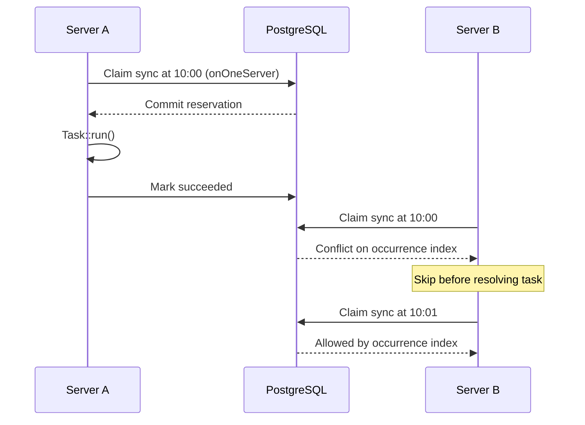
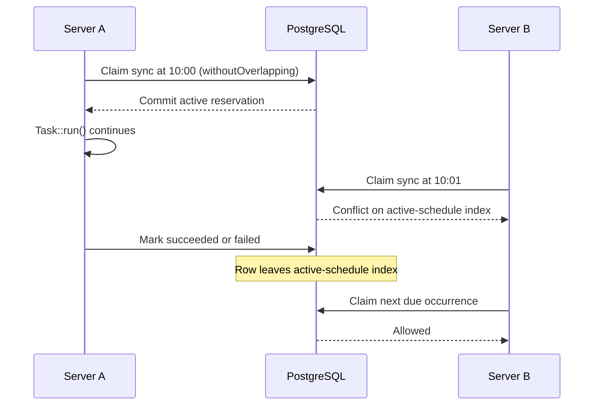
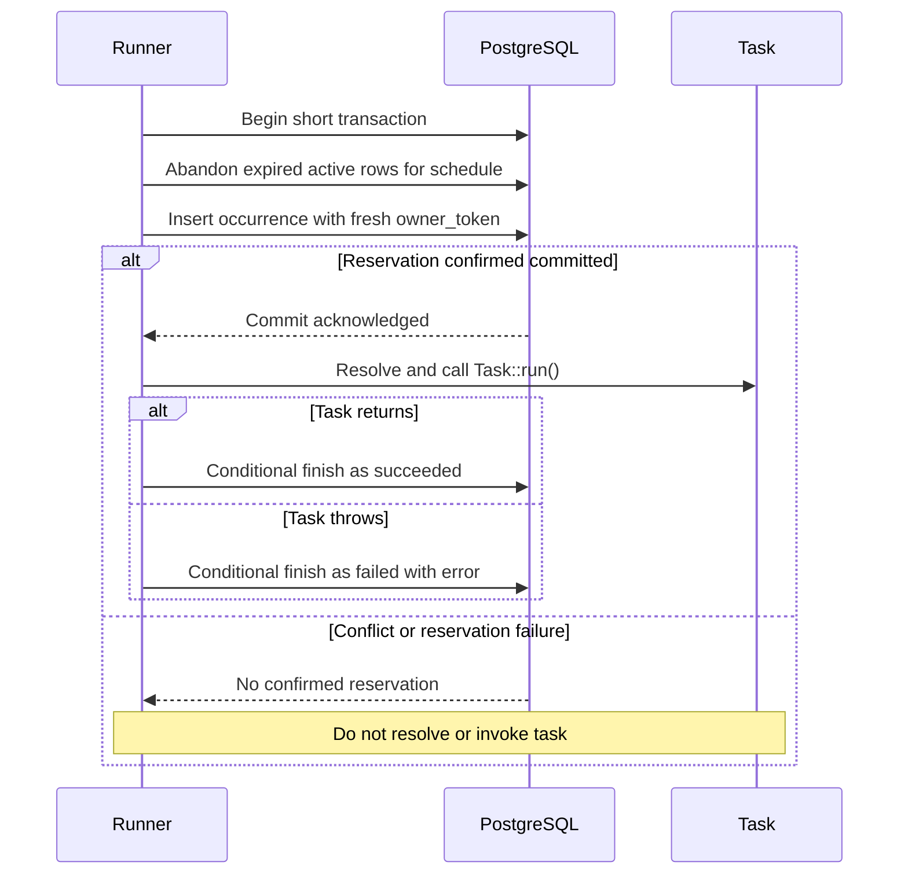

# Execution coordination

This is the target contract for the future PostgreSQL execution coordinator.
The schema exists; production reservation, renewal, recovery, and runner wiring
are not implemented. See [verification and remaining work](verification.md).

## Two independent protections

An occurrence is `(schedule_id, scheduled_for)`, where `scheduled_for` is the
intended UTC minute, shared by all scheduler processes. It is not the time at
which each process happens to start. All instances must use consistent IDs and
concurrency settings. Different IDs remain independent, even for one task class.

| Protection | Unique index | Lifetime |
| --- | --- | --- |
| `onOneServer` | `task_runs_occurrence`: `(schedule_id, scheduled_for)` where `on_one_server` | While the historical row exists, including after success, failure, or abandonment. |
| `withoutOverlapping` | `task_runs_active_schedule`: `schedule_id` where `without_overlapping AND status = 'in_progress'` | Until an explicit status transition removes the row from the predicate. |

These are partial indexes: unprotected rows are outside their predicates.
Enabling both options combines both guarantees. Disabling both permits duplicate
occurrences and concurrent executions. Enabling only overlap protection permits
the same occurrence again after the previous run finishes.

### Same occurrence on two servers

A fast completion must not let a second server execute the same occurrence.
The occurrence reservation survives all terminal states. This prevents duplicate
claims; it does not guarantee that the task completed its effects exactly once.

### Different occurrences during one long run

Only the active-schedule index blocks the next minute while the earlier run
holds a valid execution lease. Conflicts skip that invocation; they do not queue
work or create a failed execution record.

With `onOneServer` alone, the 10:01 claim is allowed even while 10:00 is running.
With `withoutOverlapping` alone, a second 10:00 claim is allowed after completion.

## Reservation and normal completion

The coordinator atomically recovers expired ownership and attempts a reservation
in a short transaction. It commits before resolving or invoking the task. It
must not keep that reservation transaction open during `Task::run()`.
A separate connection must be able to observe the reservation when the callback
starts. A losing claim never resolves the task.

A rollback leaves no reservation. Losing the commit acknowledgement is different:
the row may have committed. Do not invoke the task on an unconfirmed reservation
or blindly retry it; the row can later expire and be recovered. This deliberately
prefers a missed execution over a duplicate invocation.

## Ownership and state transitions

Each claim has a fresh unpredictable `owner_token`. Renewal and completion must
match the row ID, token, `status = 'in_progress'`, and an unexpired lease.
A lease is valid only while `now < lease_expires_at`; equality is expired.
Zero updated rows means that ownership was not confirmed. Terminal states cannot
be revived by a late callback.

| Current state | Event | Result |
| --- | --- | --- |
| `in_progress`, valid lease and matching token | Task returns | `succeeded` |
| `in_progress`, valid lease and matching token | Task throws | `failed` with diagnostic |
| `in_progress`, valid lease and matching token | Renewal succeeds | Later `lease_expires_at`, same token |
| `in_progress`, expired lease | Explicit recovery | `abandoned` |
| Terminal, wrong token, or expired lease | Renewal or completion | Rejected, row unchanged |

Use one authoritative clock for ownership decisions, preferably database time.
Production statements must evaluate time after any relevant lock wait; a stale
transaction-start timestamp must not authorize an expired owner. Contract tests
use a controlled clock instead of sleeping. The production clock and its SQL
expression still need implementation and real-database verification.

`abandoned` means that execution ownership or outcome cannot be confirmed. It
does not mean that the process stopped or that its changes were rolled back.
See [recovery scenarios](recovery.md) and [external effects](external-effects.md).
