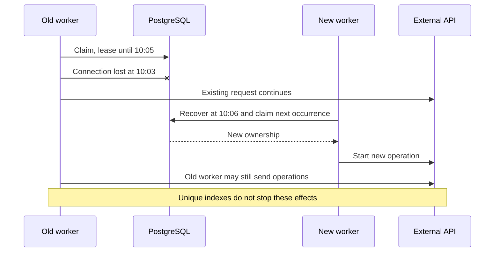
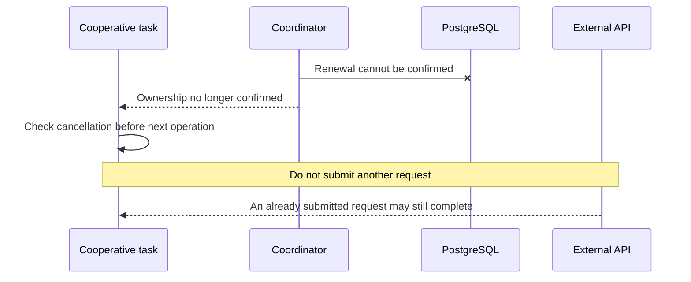
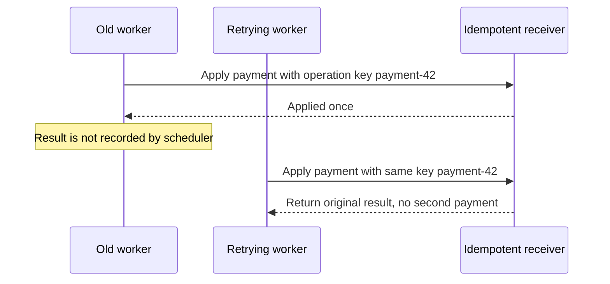
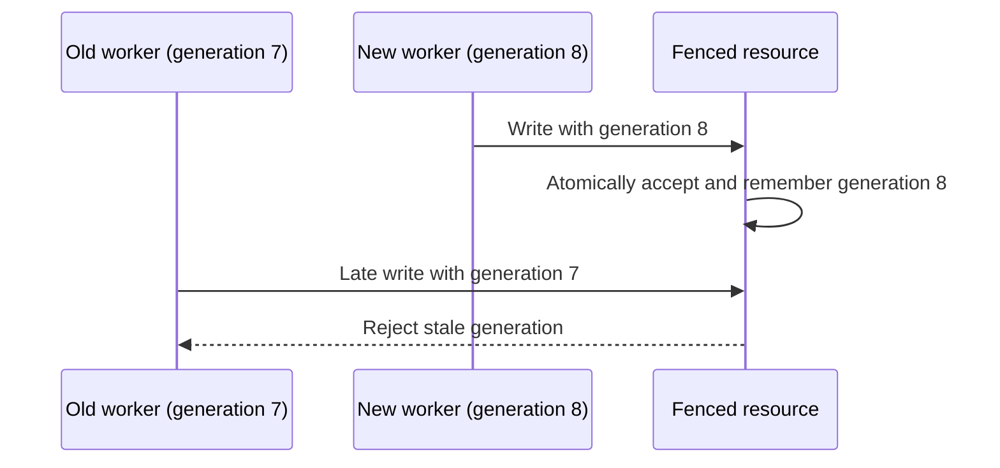

# Ownership and external effects

A lease authorizes a worker for a limited time. Expiring it or changing a row to
`abandoned` cannot terminate that process, cancel an HTTP request, or undo its
changes. This page defines task-level obligations outside the scheduler's
reservation indexes. See [recovery](recovery.md) for the database lifecycle.

## Network partition and a surviving worker

The old worker can lose access to PostgreSQL while retaining access to an
external API. Releasing its reservation then allows real execution overlap.

`withoutOverlapping` prevents multiple active protected reservations. After lease
loss, it cannot unconditionally guarantee that only one physical process is
still executing task code. An arbitrary uncooperative task can keep running.

## Cooperative ownership checks

A task that supports cancellation checks ownership before starting another
operation. Failed renewal must be reported as lost or unconfirmed ownership,
not treated as permission to keep working.

A check and an external write are separate actions: ownership may expire between
them. Cooperative cancellation reduces the window but does not close it.

## Idempotent business operations

Use a stable business operation key at a receiver that atomically deduplicates
requests. Repeated attempts for one operation must reuse that key; a new random
key on each retry defeats deduplication.

The retrying worker is illustrative; scheduler automatic retry is not part of
this design. An occurrence key deduplicates that occurrence's effects only.
Different occurrences updating the same resource may need a business key or
additional concurrency control. A receiver without an idempotency contract
cannot acquire one merely because the scheduler sends a header.

## Fencing stale owners

Fencing uses an increasing generation for the protected resource. The receiver
atomically compares the generation and applies the write. After observing a new
generation, it rejects older ones. Comparing in the worker before writing is
insufficient. An older operation arriving before the receiver observes the newer
generation is not automatically rejected by this basic scheme.

The UUID `owner_token` is an ownership credential, not an ordered fencing token.
A `task_runs.id` must not be assumed to provide the required resource-level
ordering without a separate design. The current schema and coordinator contract
do not implement fencing. It requires receiver support and an explicit resource
identity, generation allocation, and atomic enforcement protocol.

## Scope of verification

Acceptance tests use controllable worker pauses and an external-effects probe to
show that an abandoned worker can still act, and that a cooperative worker can
stop. Receiver examples test duplicate-key and stale-generation behavior through
an explicit test port. They do not prove that a real payment API or other
production receiver offers these guarantees. Each effectful task must verify
its actual receiver integration before relying on it.

See [verification and remaining work](verification.md) for the boundary between
coordinator implementation and task-specific safety work.
