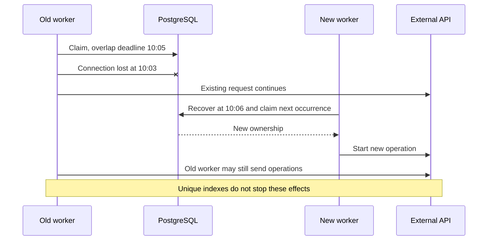
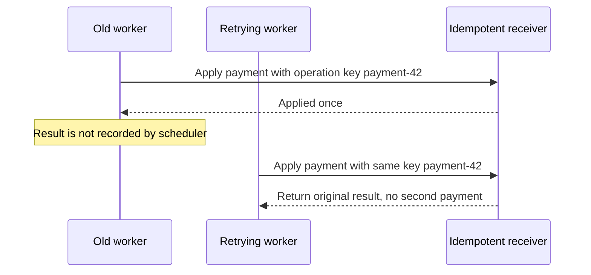
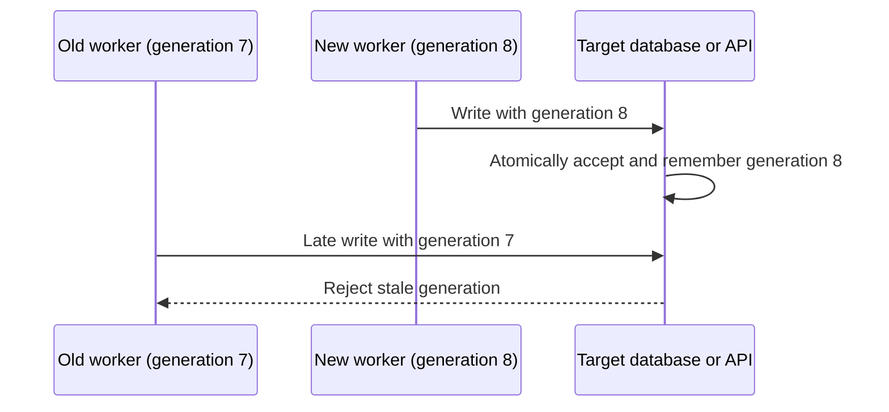

# Ownership and external effects

An overlap lock protects a reservation for a fixed time. Expiring it or changing a row to
`abandoned` cannot terminate that process, cancel an HTTP request, or undo its
changes. The scheduler coordinates reservations and run history. Business writes
made by a task need protection at their destination, as described below.
See [recovery](recovery.md) for the scheduler's database lifecycle.

## Network partition and a surviving worker

The old worker can lose access to PostgreSQL while retaining access to an
external API. Releasing its reservation then allows real execution overlap.

`withoutOverlapping` prevents multiple active protected reservations. After lock
expiry, it cannot unconditionally guarantee that only one physical process is
still executing task code. An arbitrary uncooperative task can keep running.

## Deferred cancellation support

The first version does not renew locks, signal ownership loss, or require task
checkpoints. A worker can keep executing after lock expiry or recovery. An
already submitted external request can also finish after abandonment.

Cooperative cancellation is a possible future extension. It would require an
explicit task context or cancellation interface and a way to detect lost
ownership during execution. It still could not cancel effects already accepted
by an external system. Renewal and process supervision would require their own
implementation; they are not prerequisites for fixed-expiration locks.

## Idempotent business operations

Use a stable business operation key at a receiver that atomically deduplicates
requests. Repeated attempts for one operation must reuse that key; a new random
key on each retry defeats deduplication.

The retrying worker is illustrative; scheduler automatic retry is not part of
this design. An occurrence key deduplicates that occurrence's effects only.
Different occurrences updating the same resource may need a business key or
additional concurrency control. A receiver without an idempotency contract
cannot acquire one merely because the scheduler sends a header.

## Fencing stale owners

Here, the protected resource is the business data changed by a task, such as a
product's stock quantity in a target database or API. It is separate from the
scheduler's `task_runs` and `task_locks` records, even if both use the same database.
For example, an older task run may publish an outdated stock quantity after a
newer run has already updated that product.

Fencing uses an increasing generation for the protected resource. The receiver
atomically compares the generation and applies the write. After observing a new
generation, it rejects older ones. Comparing in the worker before writing is
insufficient. An older operation arriving before the receiver observes the newer
generation is not automatically rejected by this basic scheme.

### Responsibility boundary

If fencing is required, it needs cooperation across these components:

| Component | Responsibility |
| --- | --- |
| Ownership authority | Coordinate ownership and allocate increasing generations for each business resource. This requires an explicit allocation protocol in the business integration or scheduler. |
| Task integration / business service | Receive the assigned generation and include it with every protected write to that resource. |
| Target database or API | Atomically compare the supplied generation with the latest accepted generation and apply the write only if it is not stale. |

A check inside `Task::run()` cannot provide this guarantee by itself: the task
may pause or lose ownership between checking and writing. Enforcement belongs
at the destination of the business write, in the same atomic operation as that
write. A local counter created independently by each task run is also insufficient.

### Current support

The UUID `owner_token` is an ownership credential, not an ordered fencing token.
A `task_runs.id` must not be assumed to provide the required resource-level
ordering without a separate design. The scheduler does not allocate resource-level
ownership generations or pass them to tasks for use in external writes.
The current `Task::run(): void` contract exposes no execution context carrying
such a generation, and the application has no production receiver integration
that enforces this protocol. This section describes a possible integration,
rather than an existing scheduler guarantee or a mechanism a task can implement
alone.

`schema_migrations.version` tracks database schema changes; it does not identify
ownership generations. Fencing requires receiver support and an explicit resource
identity, generation allocation, and atomic enforcement protocol.
