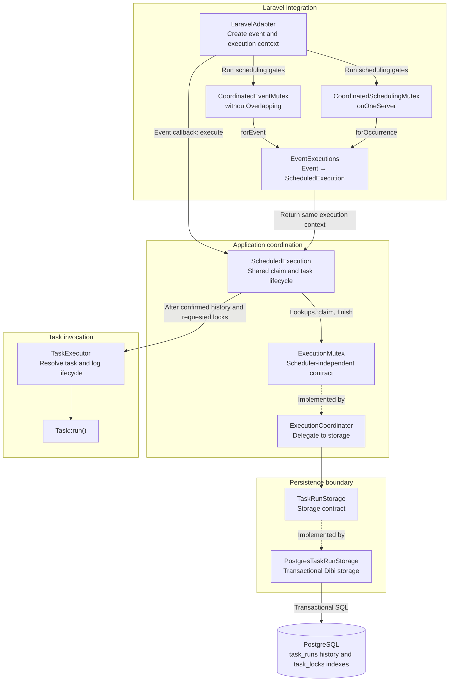
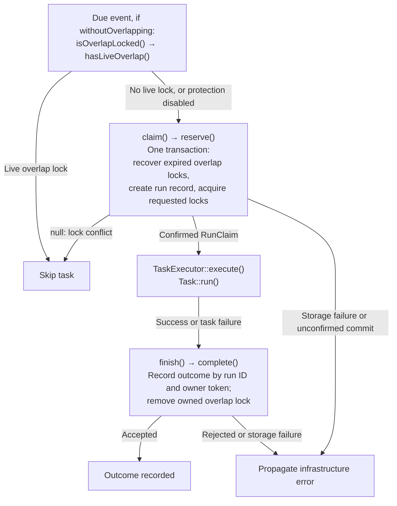
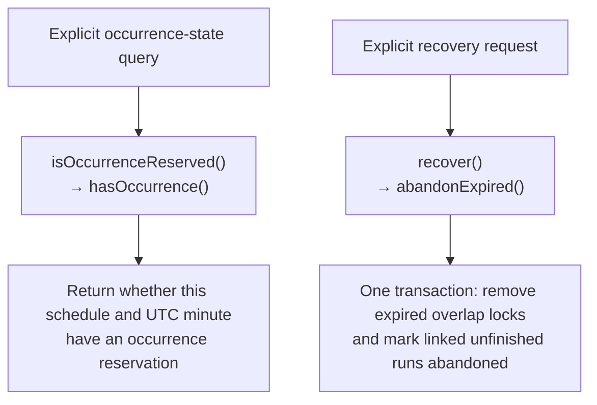

# Mutex layers

`LaravelAdapter` connects Illuminate's scheduling gates and task callback to one
`ScheduledExecution` per event. That shared execution context obtains one claim
through `ExecutionMutex`, runs the task, and records its outcome. The coordinator
delegates persistence to `TaskRunStorage`.

## Layer diagram

- Solid arrows show calls or context lookup.
- Dotted **Implemented by** arrows identify the implementations selected by
  dependency injection; they do not add another lifecycle step.
- The SQL arrow represents implemented PostgreSQL operations.
- The task branch ends at `Task::run()`; outcome persistence returns through
  `ScheduledExecution` and the storage branch.

`ExecutionMutex` and `TaskRunStorage` expose no Illuminate types.
`ExecutionCoordinator` currently translates calls directly to storage; atomic
reservation, recovery, database time, and commit confirmation belong to the
storage implementation. See [Coordination](coordination.md) for their contract
and [Recovery](recovery.md) for state transitions.

## Follow one occurrence

1. `LaravelAdapter::run()` captures the invocation time. `createSchedule()`
   normalizes it to a UTC minute and creates a `ScheduledExecution` with the
   definition and configured server ID for each event. Registration makes no storage calls.
2. `EventExecutions` stores the event-to-context mapping in a `WeakMap`. Both
   mutex adapters retrieve that same context; `forOccurrence()` also rejects a
   scheduling time outside its registered minute.
3. For a due event, `filtersPass()` performs the advisory overlap lookup when
   `withoutOverlapping` is enabled. If `onOneServer` is enabled,
   `serverShouldRun()` requests a claim through `CoordinatedSchedulingMutex`.
   `event.run()` then requests a claim through `CoordinatedEventMutex` when
   overlap protection is enabled. See the [execution gates](../adapter/laravel.md#execution-conditions).
4. Both mutex `create()` methods call `ScheduledExecution::claim()`. It caches
   the attempt and its result, so enabling both options produces one storage
   reservation with both flags. A local claim does not block itself in the
   overlap lookup. A denied claim skips task resolution and invocation.
5. The event callback calls `ScheduledExecution::execute()`, which reuses the
   claim or obtains it before calling `TaskExecutor::execute()`. With both
   protections disabled, it still records a fresh run, without acquiring locks.
6. For a claimed run, `ScheduledExecution` records `Succeeded` or `Failed` through
   `finish()` using the original `RunClaim` (run ID and owner token). Its `finally`
   block clears local state. `CoordinatedEventMutex::forget()` also clears only
   local state; it neither completes a database row nor removes the historical
   single-server reservation.

An advisory lookup cannot authorize execution: another process may acquire a
reservation before the atomic claim. An unconfirmed claim or storage exception
propagates without resolving the task. Rejected or failed completion also
propagates, without attempting a second outcome. Task failures whose completion
was recorded are rethrown as `TaskExecutionException`, which the adapter catches
to continue with later events.

## Coordinator-to-storage calls

| `ExecutionMutex` / `ExecutionCoordinator` | `TaskRunStorage` | Responsibility |
| --- | --- | --- |
| `isOverlapLocked()` | `hasLiveOverlap()` | Advisory lookup for a live overlap lock. |
| `isOccurrenceReserved()` | `hasOccurrence()` | Lookup for a single-server occurrence, including completed runs. |
| `claim()` | `reserve()` | Recover expired locks, record history, and acquire requested locks in one transaction; return a confirmed `RunClaim` or `null` on conflict. |
| `finish()` | `complete()` | Record the original owner's result and remove its overlap lock by run ID and token. |
| `recover()` | `abandonExpired()` | Remove expired overlap locks and abandon linked unfinished runs. |

`reserve()` is called for every task execution, even when both concurrency
protections are disabled. It still creates a `task_runs` record, but no new
`task_locks` rows.

`ScheduledExecution` does not call `recover()` separately before `claim()`.
Recovery during reservation must remain inside `reserve()`'s transaction.

### Method lifecycle

- The lookup is advisory; only a confirmed `RunClaim` permits task execution.
- The first enabled scheduling gate requests the claim. If both protections
  are disabled, the task callback requests it instead. Later calls reuse the
  cached result, so `reserve()` runs once per execution context.
- `reserve()` performs recovery internally; it does not call the public
  `recover()` / `abandonExpired()` pair.
- Completion retains the occurrence reservation. A recorded task failure is
  rethrown to the adapter; local context is cleared in `finally` even if
  completion fails.

The other two method pairs are separate entry points, outside this normal
adapter lifecycle:

- `isOccurrenceReserved()` / `hasOccurrence()` supports Laravel's
  `SchedulingMutex::exists()` contract. The current adapter flow does not call
  it: `serverShouldRun()` requests a claim through `SchedulingMutex::create()`.
- `recover()` / `abandonExpired()` allows recovery to be invoked independently.
  Current callers are tests and their worker processes. Normal scheduling
  performs recovery inside `reserve()` instead.

The diagram below completes the method overview; these calls are not additional
required lifecycle steps.

## Code map

Paths below are relative to the repository root (`src/` in the project workspace).

| Component | Source path |
| --- | --- |
| Event registration and execution gates | `app/Scheduler/Infrastructure/Laravel/LaravelAdapter.php` |
| Overlap mutex adapter | `app/Scheduler/Infrastructure/Laravel/Mutex/CoordinatedEventMutex.php` |
| Single-server mutex adapter | `app/Scheduler/Infrastructure/Laravel/Mutex/CoordinatedSchedulingMutex.php` |
| Shared event mapping | `app/Scheduler/Infrastructure/Laravel/Mutex/EventExecutions.php` |
| Per-occurrence state and lifecycle | `app/Scheduler/Application/ScheduledExecution.php` |
| Coordination contract | `app/Scheduler/Contract/ExecutionMutex.php` |
| Coordinator implementation | `app/Scheduler/Application/ExecutionCoordinator.php` |
| Persistence contract | `app/Scheduler/Contract/TaskRunStorage.php` |
| PostgreSQL storage | `app/Scheduler/Infrastructure/Database/PostgresTaskRunStorage.php` |
| Task resolution and invocation | `app/Scheduler/Application/TaskExecutor.php` |
| Claim identity and outcome | `app/Scheduler/Domain/RunClaim.php`, `app/Scheduler/Domain/RunOutcome.php` |
| PostgreSQL connection factory | `app/Database/PostgresConnectionFactory.php` |
| Database connections | `config/services/database.php` |
| Storage and coordinator aliases | `config/services/scheduler.php` |
| Laravel mutex aliases and shared event registry | `config/services/scheduler-laravel.php` |

`tests/Integration/Scheduler/LaravelLockingTest.php` checks shared claims and
execution gates. `tests/Integration/Scheduler/ExecutionLifecycleTest.php` checks
outcomes, infrastructure failures, and stable occurrence time. Both use
`RecordingExecutionMutex`. The [storage suite](storage.md#storage-tests) verifies
PostgreSQL persistence and races.
