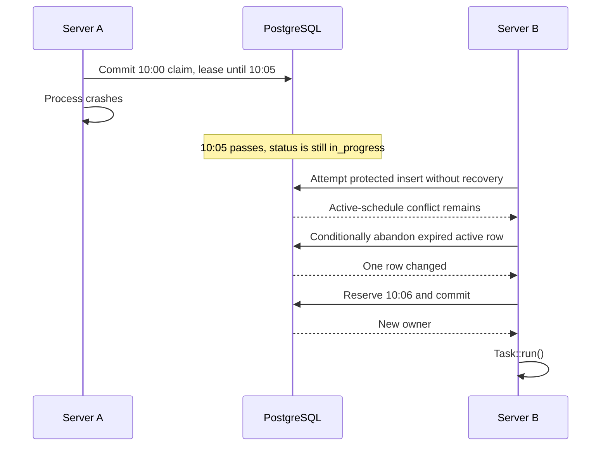
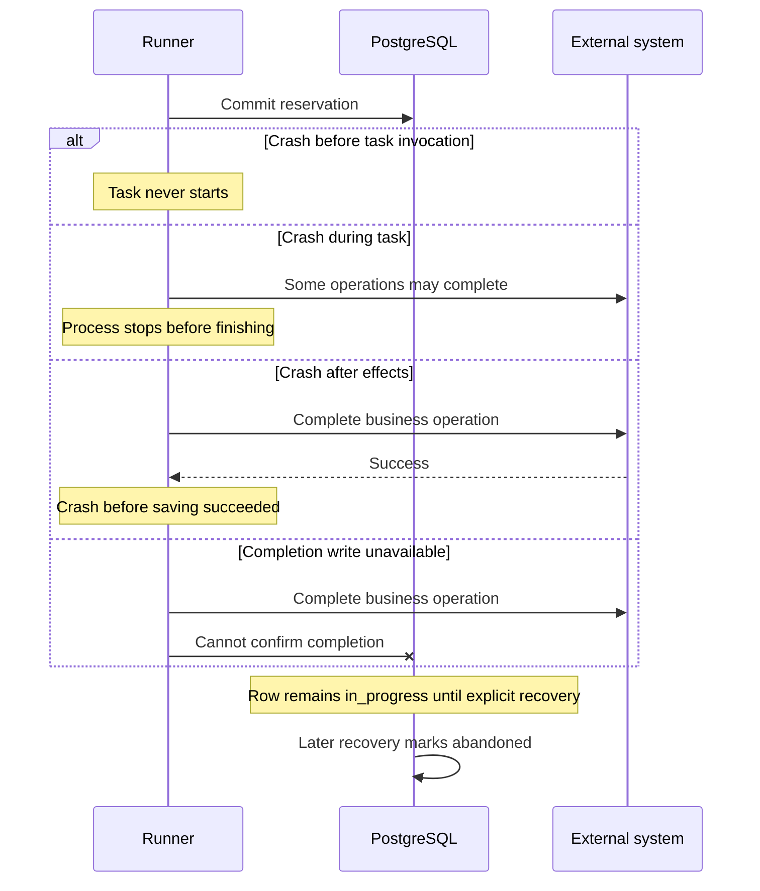
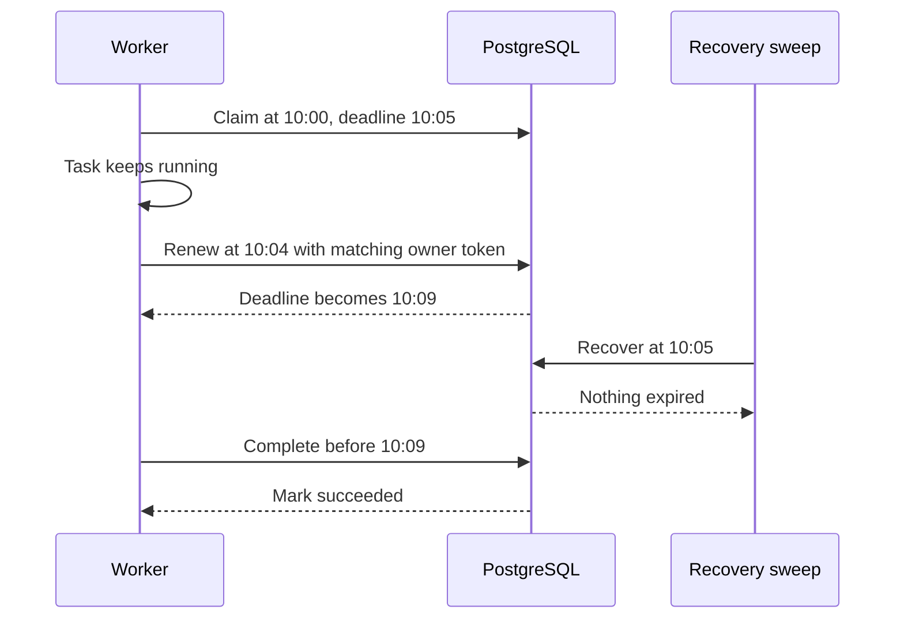
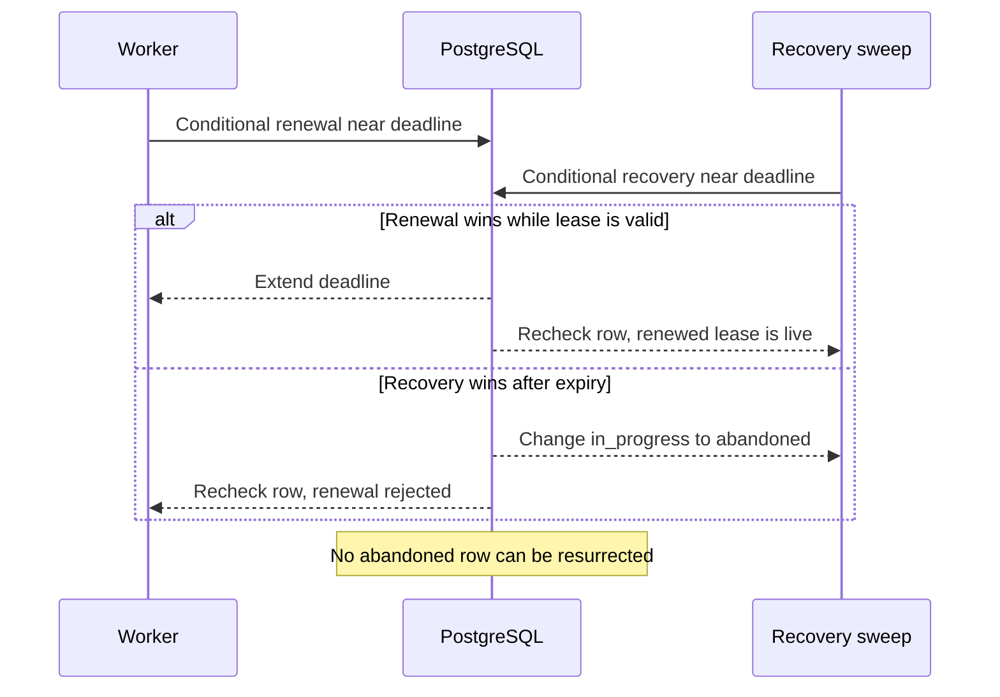
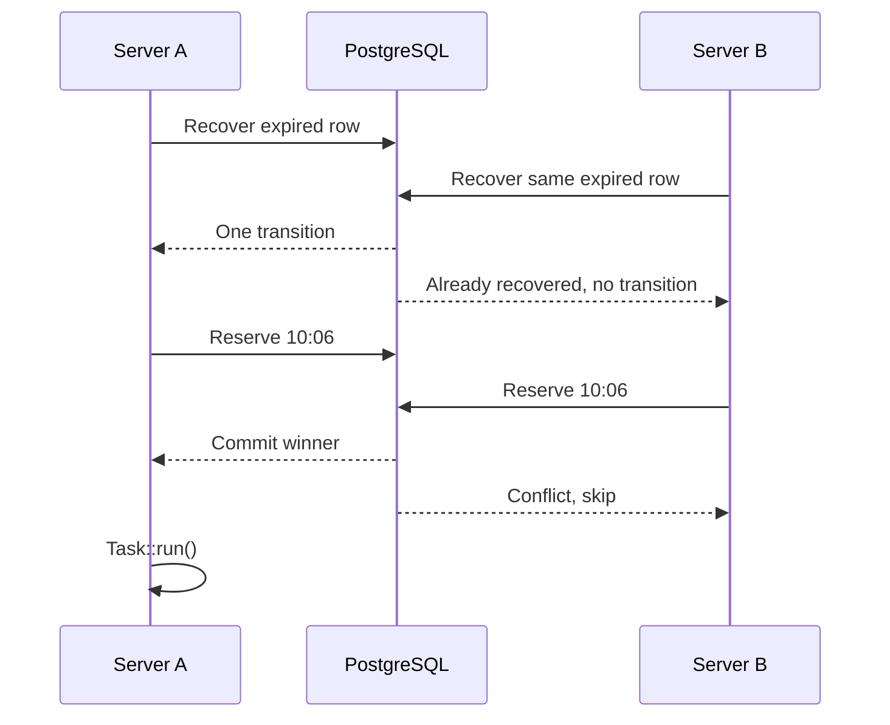
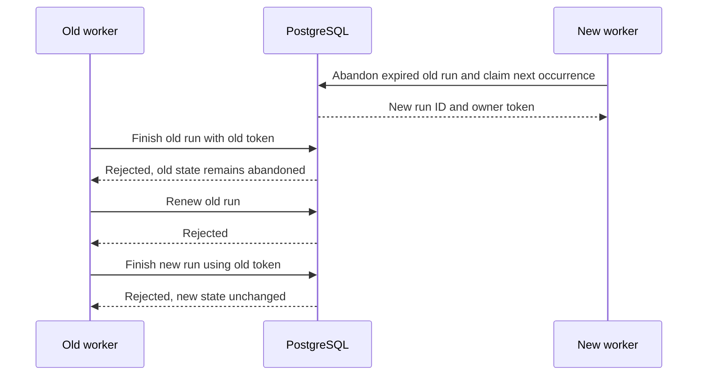

# Recovery scenarios

Recovery releases stale execution ownership so later occurrences can run.
It does not retry the abandoned occurrence or reverse its effects. These are
requirements for the future coordinator, not implemented runtime behavior.
The [coordination contract](coordination.md) defines normal execution and indexes.

## Process crash and expired lease

A process can disappear after committing its reservation. `finally` cannot
reliably clean up after a killed process, machine failure, or power loss.
Passing `lease_expires_at` does not change `status`; explicit recovery is needed.

The coordinator should recover the relevant schedule before attempting its next
claim. A periodic sweep can additionally keep history current for schedules that
have no new due occurrence. Recovery must ignore live leases and terminal rows,
be repeatable, and leave unrelated schedules untouched. History is retained.
`finished_at` on abandonment records when loss was recognized, not a proven task
completion time.

The occurrence index still contains the abandoned 10:00 row when `onOneServer`
was enabled. Reclaiming 10:00 is rejected; claiming 10:06 is allowed. Automatic
retry, catch-up, and deduplication-history deletion are outside this contract.

## Crash windows and uncertain outcomes

The point of failure determines what we know about effects, but not whether the
old lease must eventually be recovered.

The last two cases can have fully completed effects and an abandoned history
row. Recovery must never infer failure or success merely from lease expiration.
A task exception is `failed` only when the current owner can persist that result.
If the completion write is unavailable, the outcome remains unconfirmed.

## Healthy long task and lease renewal

A live owner can renew before expiry. Renewal keeps the same token and extends
the deadline; recovery must then leave the row active. The runner needs a real
renewal mechanism during a blocking `Task::run()`, such as a supervised worker or
cooperative checkpoints. A loop after `Task::run()` cannot renew a running task.

Renewal at or after the deadline is rejected, even if nobody has recovered the
row yet. An expired owner cannot bring itself back to life. A DB outage during
renewal means ownership cannot be confirmed; the runner must signal ownership
loss to cooperative tasks and stop authorizing new protected operations. It
cannot promise to cancel an already submitted external request.

## Renewal racing with recovery

Reading the row and deciding later is insufficient. Both operations must enforce
their conditions atomically under database concurrency.

Tests must exercise both controlled orders with two real connections and
barriers, including a statement that waits across the deadline. No sleeps or
single-threaded in-memory imitation can establish this database guarantee.

## Two servers recovering and claiming

Both servers can observe a stale row. Only one can perform its state transition;
both can then compete for the next protected occurrence. The unique indexes
select one winner. The losing runner must not invoke the task.

Recovery and reservation must leave valid state even when the new insert loses
or rolls back. They must not erase historical rows. Conflict handling must not
continue issuing SQL in a failed PostgreSQL transaction without rollback or an
appropriate savepoint. The implementation can use a conflict-safe insert.

## Late worker completion

A paused process may resume after its row was abandoned and another run began.
Its original token does not authorize completion or renewal anymore.

This protects scheduler history. It does not stop external operations; see
[external effects](external-effects.md). The [test plan](verification.md) maps
these scenarios to executable acceptance tests and states what remains missing.
