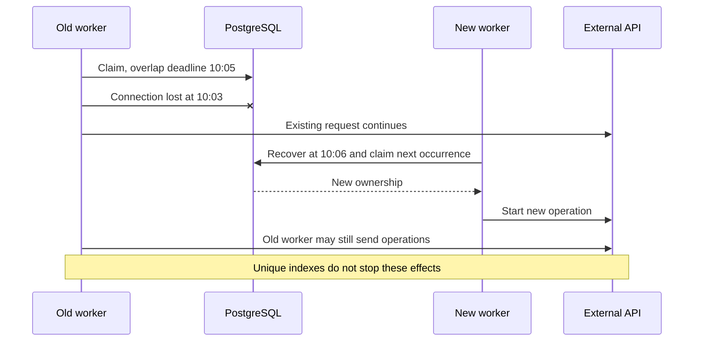
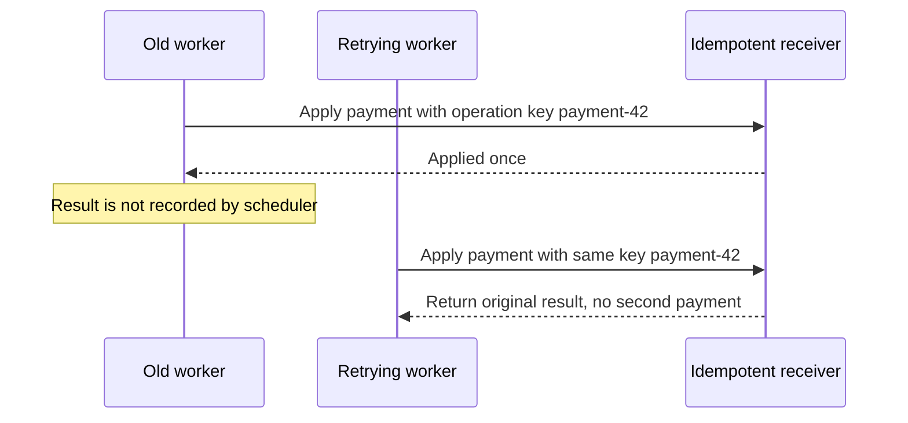
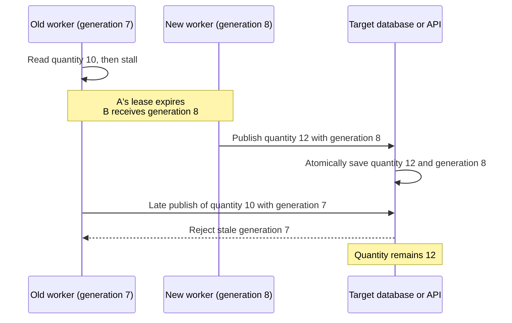

# Ownership and external effects

An overlap lock protects a reservation for a fixed time. Expiring it or changing a row to
`abandoned` cannot terminate that process, cancel an HTTP request, or undo its
changes. The scheduler coordinates reservations and run history. Business writes
made by a task need protection at their destination, as described below.
See [recovery](recovery.md) for the scheduler's database lifecycle.

## Network partition and a surviving worker

The old worker can lose access to PostgreSQL while retaining access to an
external API. Releasing its reservation then allows real execution overlap.



`withoutOverlapping` prevents multiple active protected reservations. After lock
expiry, it cannot unconditionally guarantee that only one physical process is
still executing task code. An arbitrary uncooperative task can keep running.

## Deferred cancellation support

The first version does not renew locks, signal ownership loss, or require task
checkpoints. A worker can keep executing after lock expiry or recovery. An
already submitted external request can also finish after abandonment.

Cooperative cancellation is a possible future extension. It would require an
explicit task context or cancellation interface and a way to detect lost
ownership during execution. It still could not cancel effects already accepted
by an external system. Renewal and process supervision would require their own
implementation; they are not prerequisites for fixed-expiration locks.
See [Renewable leases and ownership loss](../mutex/extensions.md#renewable-leases-and-ownership-loss)
for the required coordination and execution changes.

## Work that outlives Task::run()

The current execution boundary is task resolution followed by the synchronous
`Task::run()` call. Its return records success and releases the overlap lock.
If the task only enqueues a job, launches a detached process, or asks an API to
start asynchronous work, that return confirms dispatch rather than completion
of the resulting work. A later occurrence can dispatch another operation while
the earlier one is still running.

This is a scope issue in both our adapter and scheduler-level Laravel locks.
Laravel's [scheduled jobs](https://laravel.com/docs/13.x/scheduling#scheduling-queued-jobs)
dispatch work to a queue; the scheduler's mutex is not automatically a lock on
the entire queued job lifetime.

Protect the actual execution in its worker or business service. An alternative
would be an explicit ownership handoff with worker acknowledgement, lease
validation, and worker-reported completion. Neither is implemented as a scheduler
feature here. Passing today's internal claim to a delayed worker without such a
protocol can leave that worker using an already expired reservation. See
[Work performed by another worker](../mutex/extensions.md#work-performed-by-another-worker)
for the extension boundary.

## Idempotent business operations

Use a stable business operation key at a receiver that atomically deduplicates
requests. Repeated attempts for one operation must reuse that key; a new random
key on each retry defeats deduplication.



The retrying worker is illustrative; scheduler automatic retry is not part of
this design. An occurrence key deduplicates that occurrence's effects only.
Different occurrences updating the same resource may need a business key or
additional concurrency control. A receiver without an idempotency contract
cannot acquire one merely because the scheduler sends a header.

## Fencing stale owners

Fencing prevents an old worker from overwriting a newer owner's accepted work.
For example, A reads stock quantity 10 and stalls. Its replacement B publishes
quantity 12. When A resumes, its outdated quantity 10 must be rejected.



This is not implemented. One possible integration would work as follows:

1. When granting ownership of `stock:SKU-42`, a shared authority allocates an
   increasing generation: A gets 7, B gets 8. Allocation must follow ownership
   grant order for that resource, including across different schedules.
2. The executor passes that generation to the task in an execution context.
   The task forwards it with every protected write through its business service.
3. The target database or API atomically checks the generation and applies the
   write, remembering the highest accepted generation. It rejects older writes.

For example, a future task API could expose the context explicitly:

```php
public function run(ExecutionContext $context): void
{
    $quantity = $this->warehouse->readQuantity('SKU-42');
    $this->stockWriter->publish(
        sku: 'SKU-42',
        quantity: $quantity,
        generation: $context->generation('stock:SKU-42'),
    );
}
```

`ExecutionContext` is illustrative: today's `Task::run(): void` receives no
context. This design would require an API change, generation allocation, and
receiver support. Every protected write must use the generation-aware writer;
direct writes bypass it.
