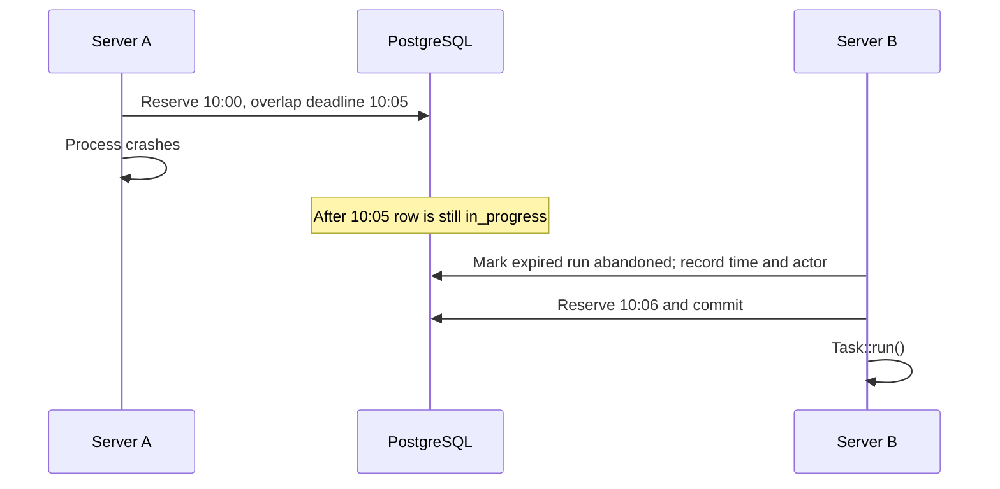
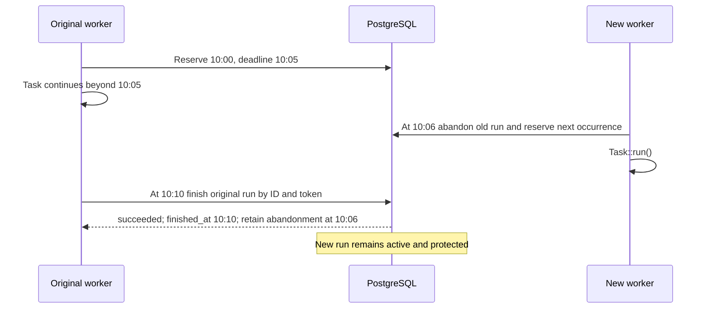

# Recovery scenarios

Recovery frees an expired overlap reservation so a later occurrence can run.
It does not retry abandoned work or reverse its effects. The
[PostgreSQL storage](../coordination/storage.md) implements these transitions; see
[coordination](../coordination/contract.md) for the contract.

## Recovery before reservation

A killed process or failed machine cannot reliably run cleanup. At the next
claim for that schedule, remove expired overlap locks from `task_locks` and
mark linked `in_progress` history rows abandoned before attempting the new
reservation, using short transactional database operations.

Recovery writes `abandoned_at` and `abandoned_by`, leaving `finished_at` empty.
It ignores live overlap locks, completed rows, already abandoned rows, and rows
without overlap protection. Repeated recovery preserves the original attribution.
It must leave other schedules untouched and retain historical rows.

No periodic sweep is required in the first version. A stale history row may
remain `in_progress` until another invocation attempts a reservation for that
schedule. A sweep for monitoring or schedules that never run again is a possible
extension, not a correctness requirement for the next claim.

With `onOneServer`, the abandoned occurrence remains reserved. A new 10:06
occurrence may run, but 10:00 cannot be reclaimed. Automatic retry, catch-up, and
retention that deletes occurrence locks are separate features. Deleting history
does not release these locks; see [History and locks](../coordination/history.md).

## Long tasks without renewal

The deadline is fixed when the run is reserved. There is no heartbeat, renewal
supervisor, task cancellation signal, or automatic termination on expiry.
A healthy task must normally finish within the configured overlap duration.
Renewal and cancellation are possible extensions, with the additional protocol
described in [Renewable leases and ownership loss](../mutex/extensions.md#renewable-leases-and-ownership-loss).

A late return is success; a late exception is failure with its diagnostic.
Completion may change `abandoned` to `succeeded` or `failed`, but never restores
active ownership. The original row's ID and token cannot complete a new row.
Both success and failure use `finished_at`; abandonment fields remain intact.

Completion after expiry without intervening recovery is accepted too. In that
case abandonment fields remain empty: expiry alone is not a recovery event.
A task crossing expiry must not be rejected merely because its completion SQL
waited for a database row lock.

## Recovery racing with completion

The database must serialize competing transitions and recheck row conditions.
Both controlled orders are valid:

| First committed transition | Required final state |
| --- | --- |
| Completion | Recovery finds no overlap lock and does nothing; abandonment fields remain empty. |
| Recovery | Original completion records success or failure and preserves recovery time and actor. |

A confirmed `succeeded` or `failed` result cannot subsequently be overwritten.
The race must not resurrect `in_progress` or affect a replacement run. Tests use
two real connections and barriers, including a row-lock wait crossing expiry.

Two servers can also recover and claim concurrently. Only one transition should
record abandonment; both can compete for the next occurrence, with the unique
indexes choosing the winner. A losing claim must never resolve the task.
Conflict handling must leave a usable transaction, for example through a
conflict-safe insert, rather than continuing in an aborted PostgreSQL transaction.

## Crash windows and uncertain outcomes

| Failure point | What recovery can know |
| --- | --- |
| After commit, before task invocation | Reservation exists; there may be no business effects. |
| During task execution | Some effects may have completed. |
| After effects, before completion write | Business work may be complete even though the outcome is unknown. |
| Completion write unavailable | The worker cannot confirm that its result was stored. |

In every case the row may remain `in_progress` until recovery marks it
`abandoned`, with `finished_at` still empty. Recovery must not infer success or
failure from expiration. If the original process later successfully reports its
result, update only its row and retain the recovery evidence.

Expiry or abandonment cannot stop external operations. A surviving worker may
continue using an API while disconnected from PostgreSQL. See
[external effects](external-effects.md) for the resulting limits.
