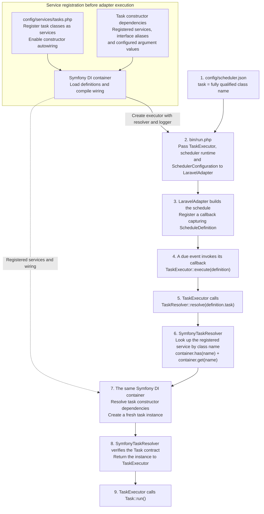

# Why SymfonyTaskResolver is needed

The scheduler configuration identifies a task by its fully qualified class name.
`SymfonyTaskResolver` connects that name to a registered Symfony service, so the
container can create the task with its constructor dependencies. `TaskExecutor`
uses the application-owned `TaskResolver` contract, keeping Symfony container
access outside the adapter and executor.

## From configured class name to running task

The solid arrows show preparation and execution order. The dotted arrow connects
runtime task creation to the service registrations prepared earlier. Task
instances are created only when their callbacks execute.

## How the flow fits together

- **A class name selects the task.** The `task` field in
  `config/scheduler.json` contains a fully qualified PHP class name. The class
  must implement `Task` and be registered as a service under that name in the
  Symfony container. Here, `config/services/tasks.php` automatically registers
  classes from `app/Task/Execution/`; an individual service definition for each
  task is unnecessary. The JSON entry selects a service; it does not register it.
- **Task constructor dependencies must be resolvable.** Each required object
  parameter in a task's constructor needs a corresponding service registration,
  either explicit or automatic. Interface types need a matching service alias or explicit argument
  binding. Scalar arguments need configured values unless a usable default
  exists. For example, `LoggerInterface` is aliased to the configured logger in
  `config/services/logging.php`. The same requirement applies to dependencies
  of those services. See [Task services](task-services.md) for registration details.
- **Symfony DI constructs the complete object.** Autowiring connects registered
  services using constructor parameter types. When the task is requested, the
  container obtains its dependencies and injects them into a fresh task instance.
  Dependencies may themselves be shared services; they are not necessarily
  constructed again. A class name alone, or `new $taskClass()` without arguments,
  cannot supply this configured dependency graph.
- **The adapter receives the executor and configuration.** `bin/run.php`
  retrieves `TaskExecutor` from Symfony DI and passes it to `LaravelAdapter`
  together with `SchedulerConfiguration` and the scheduler runtime. Each parsed
  `ScheduleDefinition` still carries the task class name as a string.
- **The scheduler triggers execution through a callback.** The adapter creates
  the schedule and registers callbacks that capture their definitions. When a
  due event is allowed to run, its callback calls
  `TaskExecutor::execute(ScheduleDefinition $definition)`. Task instances are
  not resolved while the schedule is being built.
- **The resolver bridges the executor and container.** `TaskExecutor` receives a
  `TaskResolver`; the service alias selects `SymfonyTaskResolver`. The executor
  calls `resolve($definition->task)`. The resolver uses its injected Symfony
  container to retrieve the registered service and checks that it implements
  `Task`. The container performs construction and dependency injection. The
  separate Illuminate runtime used by Scheduler does not supply these task
  services.
- **The executor runs the resolved task.** The resolver returns the ready task
  instance to `TaskExecutor`, which calls `Task::run()`. Scheduler invokes the
  callback; `TaskExecutor` performs the actual task invocation. Resolution and
  execution errors follow the existing [task execution policy](task-execution.md).

## Benefits and alternatives

- **Task dependency wiring:** DI supplies the dependencies required by each
  task's constructor.
- **Construction on demand:** Tasks skipped by scheduling conditions are not
  instantiated.
- **Container independence:** `TaskExecutor` uses `TaskResolver` instead of a
  particular container API. The resolver isolates lookup and container error
  translation.
- **Reusable execution:** Another scheduler adapter can use the same executor.
- **Focused tests:** Executor tests can replace the small `TaskResolver`
  contract without setting up a DI container.

Drawbacks of the current design:

- **Additional indirection:** An interface, implementation and service alias
  need maintenance and add another call to follow.
- **Broad container access:** `SymfonyTaskResolver` still receives the whole
  Symfony container.
- **No validation or performance guarantee:** The resolver layer itself does
  not detect configuration errors earlier or improve task construction performance.
  Early task-reference validation is proposed in
  [issue #12](https://github.com/pupitooo/emorfiq-adapter/issues/12)
  and is not implemented in this version.

### Alternatives

The relevant alternatives keep task construction and dependency wiring in a DI
container. For this application, the choices are using the existing Symfony
container directly or consolidating application services in Laravel.

Putting the Symfony container directly in `TaskExecutor` preserves deferred task
construction, shared dependencies and fresh task instances. The resolver adds a
boundary around container access; the container supplies these construction
capabilities. Using PSR-11 for container access is a variation of this approach:
it reduces dependence on Symfony's API, but task checks and error handling still
belong to the executor. The executor can be tested using a container test double.

| Approach | Benefits | Drawbacks |
| --- | --- | --- |
| Symfony container inside `TaskExecutor` | Removes the resolver layer while retaining existing service definitions, DI and construction on demand. | Service lookup, `Task` checks and container error handling move into the executor. The executor depends on the selected container interface. |
| Laravel container for all application services | One container handles both the scheduler runtime and task dependencies, simplifying bootstrap wiring. | Existing Symfony service definitions need replacement while preserving task lifetime and logger wiring. Direct container access couples the executor to the selected container interface; keeping a resolver retains its maintenance cost. |

### Choosing the abstraction

In practice, start with the framework the team prefers, the application already
depends on, and the team is satisfied with. When that framework meets the
application's needs and there is no concrete requirement to support another,
omitting the resolver abstraction can be preferable. Using the chosen
framework's container directly in `TaskExecutor` keeps fewer layers to understand
and maintain.

Supporting multiple implementations can complicate future features. A feature
that uses framework-specific behavior may require changes to the shared contract,
updates to each integration, or additional special cases. The current design also
requires following the adapter, scheduler callbacks, executor, resolver and DI
container to understand how a configured task runs. That cost matters when
deciding whether the flexibility is useful in this application.

A separate resolver remains useful when supporting different container
integrations is an actual requirement. The two-container setup here follows from
combining Symfony-managed application services with the Illuminate scheduler
runtime; it is not required by the `TaskResolver` contract.
